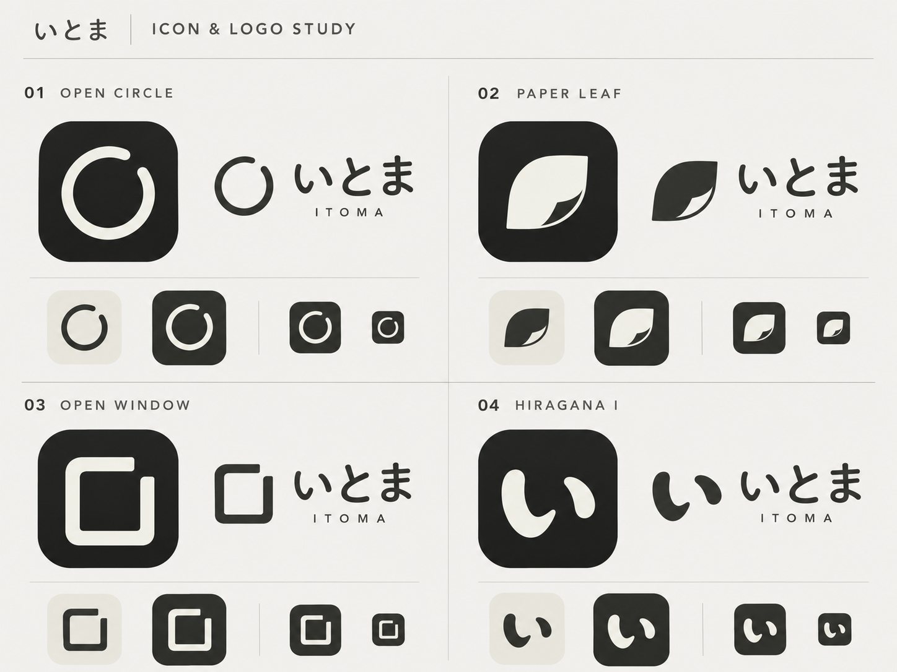

# サークルUIとOPEN CIRCLEのブランド方針

状態: 本人による方向の選択。砂時計の比較後、元のサークルUIを継続し、ロゴは候補01「OPEN CIRCLE」を選択した。[作業Issue #73](https://github.com/kzk-maeda/itoma/issues/73)。

## 選択した図案

下の候補ボードの左上「01 OPEN CIRCLE」を参照する。右上に開きのある円と、丸い線端が特徴。画像は会話で提示した元の比較資料であり、配布用の完成アセットではない。



## 実装への接続

| 用途 | 契約 |
| --- | --- |
| ロゴ・アプリアイコン | 開きのある円を固定のブランドマークとして使う。開きの位置や量は残り時間に連動させない。回転・点滅・読込表現に使わない |
| ホームの残り時間 | B案の円形リングを継続。実際の残り時間に円弧を連動させ、数値と終了時刻を併記。意味はUIガイドラインU05/U06・UI受入条件UI02/UI28に従う |
| 配色 | 05「墨と白」のLight/Darkトークンに合わせる。元ボードの陰影・質感や近似色をそのまま実装値にしない |
| 名称の併記 | 「いとま」の名称を読める文字で添える。単独の装飾マークは読み上げず、操作要素なら機能名を付ける |

ロゴと時間表示の共通する円が、アプリ内外の印象をつなぐ。開きは余白の表現であり、進捗の欠けや未完了の意味を持たせない。

## 完成アセットで確認すること

- 開き・線幅・線端をベクターで整え、小サイズでも開きが潰れず識別できるか確認する。
- Light/DarkとiOSホーム画面で確認する。元画像の角丸タイルをそのまま最終アイコンとして切り出さない。
- 文字ロゴの書体・利用条件・間隔を確定する。元ボードは生成した比較画像で、正式なフォント指定ではない。

ホーム内のマークは`src/components/home/open-circle.tsx`で固定の開いた円として描画する。本体アイコンは下記の同じパスへ揃える。スプラッシュ・faviconは今回の置換に含めない。砂時計デモは比較資料として残し、製品の標準にはしない。サークルの既存デモは[配色比較の05](https://itoma-demo.kzk-maeda.com/demos/demo-color-variations-4d21695efd01/design-colors.html?palette=graphite)で確認できる。

## 端末ビルド用アセット

[子Issue #240](https://github.com/kzk-maeda/itoma/issues/240) / [親Issue #184](https://github.com/kzk-maeda/itoma/issues/184)。設定・アセットの実装と、実機やストア掲載用画像の検証を分ける。

| 外観 | ベクター原本 | ビルド用PNG | 背景 / 円弧 |
| --- | --- | --- | --- |
| Light・共通fallback | [app-icon-light.svg](../../assets/brand/app-icon-light.svg) | [icon.png](../../assets/images/icon.png) | `#F4F3F0` / `#30312F` |
| Dark | [app-icon-dark.svg](../../assets/brand/app-icon-dark.svg) | [icon-dark.png](../../assets/images/icon-dark.png) | `#1B1C1A` / `#F0F0E9` |

PNGは1024×1024、sRGB、不透明の正方形。角丸はOSに任せ、影や文字は焼き込まない。画面内と同じ40×40座標のパスを20倍し、上下左右112pxの座標余白を取る。円弧の外径は660px、線幅60px。開きと線端は固定する。配色を変更する場合は`GraphiteColors`とSVG/PNGの整合も確認する。

SVGからPNGへの生成例（現在のExpoツリーに含まれる`sharp`を使用、アプリ実行時の依存追加は不要）:

```bash
node --input-type=module <<'JS'
import sharp from 'sharp';
for (const [appearance, output] of [['light', 'icon'], ['dark', 'icon-dark']]) {
  await sharp(`assets/brand/app-icon-${appearance}.svg`)
    .toColourspace('srgb').removeAlpha().png()
    .toFile(`assets/images/${output}.png`);
}
JS
```

`app.json`の共通`icon`と`ios.icon.light/dark`がこれらを参照する。iOS専用設定は共通設定より優先するため、共通PNGだけの変更では以前の`assets/expo.icon`が残っていた。Expo SDK 58の`IOSIcons`型と`withIosIcons`の生成処理に合わせ、PNG appearance指定を使う。古いIcon Composer素材は参照しないが、この作業で他用途の未使用アセットを一括削除しない。

### 端末への適用

アイコンはnative binaryに含まれる。Expo Go、Metroのリロード、OTA更新だけではOSホームのアイコンは変わらない。

既に`ios/`を生成済みなら、従来のScreen Time・App Group等のビルド環境変数を設定したまま、次を実行する（macOS/Xcodeと従来の署名設定が必要）:

```bash
npx expo prebuild --platform ios --no-install
npx expo run:ios --device
```

`--clean`で既存のnative projectを消さず、CNGで設定を反映して再ビルドする。`ios/`を生成するクラウドビルドでも、新しいnative buildが必要。既存の署名やbundle identifierは変更しない。

確認するものは、生成した`AppIcon.appiconset`の通常/Dark画像とXcodeの`AppIcon`参照、ビルド対象SHA、インストールした端末のOSホーム・設定上の表示・Light/Dark外観。生成確認だけで実機検証済みとはしない。小サイズの識別性、iOSの外観選択（Tintedを含む）、archive、ストア掲載用画像は#184の残る検証ゲート。
