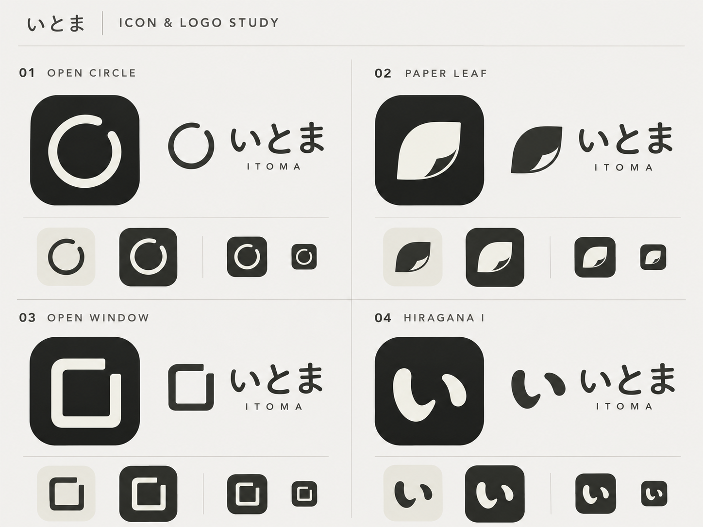

# サークルUIとOPEN CIRCLEのブランド方針

状態: 本人による方向の選択。砂時計の比較後、元のサークルUIを継続し、ロゴは候補01「OPEN CIRCLE」を選択した。[作業Issue #73](https://github.com/kzk-maeda/itoma/issues/73)。

## 選択した図案

下の候補ボードの左上「01 OPEN CIRCLE」を参照する。右上に開きのある円と、丸い線端が特徴。画像は会話で提示した元の比較資料であり、配布用の完成アセットではない。

## 実装への接続

| 用途 | 契約 |
| --- | --- |
| ロゴ・アプリアイコン | 開きのある円を固定のブランドマークとして使う。開きの位置や量は残り時間に連動させない。回転・点滅・読込表現に使わない |
| ホームの残り時間 | B案の円形リングを継続。実際の残り時間に円弧を連動させ、数値と終了時刻を併記。意味はUIガイドラインU05/U06・UI受入条件UI02/UI28に従う |
| 配色 | 05「墨と白」のLight/Darkトークンに合わせる。元ボードの陰影・質感や近似色をそのまま実装値にしない |
| 名称の併記 | 「いとま」の名称を読める文字で添える。単独の装飾マークは読み上げず、操作要素なら機能名を付ける |

ロゴと時間表示の共通する円が、アプリ内外の印象をつなぐ。開きは余白の表現であり、進捗の欠けや未完了の意味を持たせない。

## 完成アセットで確認すること

- 開き・線幅・線端をベクターで整え、小サイズでも開きが潰れず識別できるか確認する。
- Light/DarkとiOSホーム画面で確認する。元画像の角丸タイルをそのまま最終アイコンとして切り出さない。
- 文字ロゴの書体・利用条件・間隔を確定する。元ボードは生成した比較画像で、正式なフォント指定ではない。

今回の変更は方向の記録。本体のアイコン・スプラッシュ・faviconはまだ置換していない。砂時計デモは比較資料として残し、製品の標準にはしない。サークルの既存デモは[配色比較の05](https://itoma-demo.kzk-maeda.com/demos/demo-color-variations-4d21695efd01/design-colors.html?palette=graphite)で確認できる。
