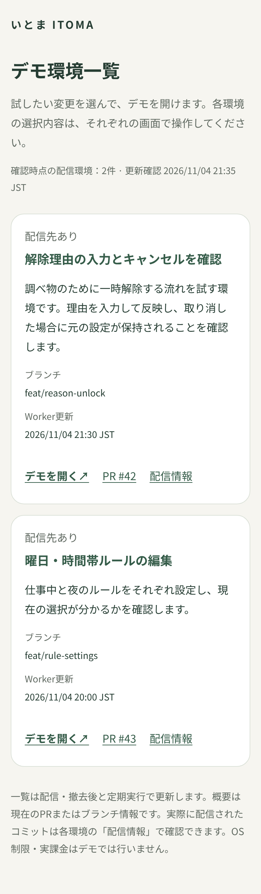
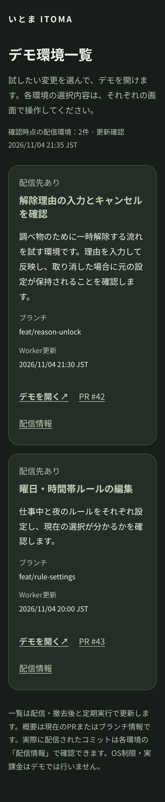

# デモ環境一覧の検証

## 目的と設計判断

確認したい変更を選び、各ブランチデモへ進む入口をドメイン直下に用意する。PRのタイトル・概要を中心に、環境へのリンクと確認時刻を表示する。iOS製品の画面・OS機能は変更しない。

既存の緑と明るい背景・ダーク表示を引き継ぎ、サマリーと遷移先の読みやすさを優先した。操作リンクは44px以上、フォーカスを明示、長い名前と文字拡大を折り返しで扱う。デプロイ完了の推測ではなくWorkerと2本のRouteを照合する。

## 検証結果

- PASS: 型チェック、Lint、Jest 2件、デモツール8件（一覧テスト5件を含む）
- PASS: 既存 `npm run demo:package`。一覧用 `wrangler deploy --config wrangler.demo-index.jsonc --dry-run`
- PASS: workflow YAML解析、差分チェック
- PASS: Chromium 390×844 Light、320×667 Dark、キーボードでリンクへ移動、200%文字拡大時の横方向オーバーフローなし
- FAIL: Expo Doctor 19/20。既存7パッケージの推奨バージョン不一致（#6）

## 画像

以下は固定サンプル2環境を生成したローカルHTTP表示。実アカウントの環境数・PR・配信結果を示すものではない。画像のPR #42/#43はサンプル値。

| Light 390px | Dark 320px |
| --- | --- |
|  |  |

## 制約・次の確認

- Cloudflare API・GitHub API照合はmockで検証。実アカウントでのAPI権限、mainに追加後の一覧workflowと実ドメインの認証後表示は未検証。
- 既存Access・DNS・ブランチRouteの変更は行っていない。ルートへの実配信も未実施。
- mainへのマージ後、Actionsの「Update demo index」を実行し、匿名アクセスの拒否、認証後の一覧、実在環境のリンク、撤去後の更新を確認する。
- PR #33のCleanup demo完了にも連動する。両PRでpackage.jsonのtest:demoを変更する場合、マージ時は `node --test tests/demo*.test.mjs` として既存・撤去・一覧を全て含める。
- スナップショットのため更新は遅延し得る。API失敗時は前回のページが残り、画面の確認時刻で鮮度を判断する。
- iOS Simulator・iPhone実機・VoiceOverは未検証。ネイティブビルドは変更なし。
