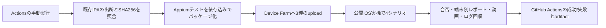

# Device FarmによるiOS実機E2E

[#156](https://github.com/kzk-maeda/itoma/issues/156)の実行基盤。**コード実装とAWS実機での合格は別**。初期範囲は公開端末上の通常UIスモークで、AWS認証・Project・Device Pool・署名済みIPAは実行時に用意する。

## 実行の流れ



[workflow](../.github/workflows/device-farm-e2e.yml)は`workflow_dispatch`のみ。push/PR/定期実行では有料テストを起動しない。同repo内の実行を直列化し、poolの`maxDevices`は1〜3、1jobは10分、upload/queueを含む待機は45分。完了は15秒間隔で確認する。AWSリージョンは`us-west-2`に固定する。

テストコードと実行スクリプトは手動実行時に選んだworkflow refのSHAから取得する。IPA artifact内のスクリプトは実行しない。アプリのSHAとテスト/workflowのSHAを別々に記録する。初回はこの変更を含むIPAを作る必要があり、旧IPAを指定すると追加ID/ビルドmarkerの照合で失敗する。

## 公開端末で確認するシナリオ

| ID | 操作と期待結果 | 対応するUI受入条件 |
| --- | --- | --- |
| DF01 | 新規インストール→起動。埋込みJSのSHA一致、ルールなし、解除入口なし | UI01 |
| DF02 | 設定→ホーム。保存ルールなし・許可確認が必要という表示。解除入口なし | UI01/UI17の未認可表示部分 |
| DF03 | 振り返り→月次→週次→ホーム。選択が実際に切り替わり、未確定の累計は「—」のまま | U08、記録なし/不明の表示契約 |
| DF04 | 設定→選択の記録→戻る→ホーム。通常の入口と戻る操作で到達する | U08の通常画面遷移部分（VoiceOverは別） |

各シナリオの前に本体プロセスを再起動する。各シナリオ後に画像とUI hierarchyを保存する。Appium 3・XCUITest・Node24・`macos_tahoe`/Xcode27を使い、公開iOS18以上の端末だけを許可する。依存の実版はログに残す。WDAはdriver majorに対応するAWS提供の署名済み版を使い、不明な版へ自動fallbackしない。

mockやテスト用の認可迂回をアプリへ追加しない。追加した`testID`は画面の識別だけで、見た目・読み上げ名・製品動作は変えない。DESIGN原則1/3/4に沿い、保存・認可・実効制限を混同しない。理由やアプリ選択tokenをIDへ含めない。

公開端末ではiOSアプリがAWSにより再署名され、App Groupsなどが除去される。このため、**Family Controlsの認可、Picker、実Shield、一時解除、Extension callback、host kill中の期限再制限、App Groups/File Protectionの成立は合格範囲に含まれない**。未認可/利用不可の表示は正当なテスト状態だが、Screen Timeの実動作の証明にはならない。#26/#49/#50/#52/#131/#135の実機ゲートは維持する。

本シナリオは現在のmain通常フローを対象とする。オンボーディング等の入口を変更するPRは、対応するE2Eも更新する。新しい画面のテストを通すために未マージの製品仕様を先取りしない。

専用端末で実制限まで自動化する場合は別シナリオにする。private device登録・対応profile/entitlement・再署名skip・テスト対象アプリ・OS認可手順の実測が必要で、このworkflowはprivate poolを拒否する。

## 初回設定

### AWS

AWSコンソールまたはCLIで、`us-west-2`にProjectと**自分のProject配下のDevice Pool**を作る。最初は公開iPhone1台へ固定し、`maxDevices=1`を明示する。無制限pool/汎用curated poolはこのworkflowで使わない。IPAアップロード後、互換性・端末数・OS・公開fleetを確認してからScheduleRunする。確認済み端末ARNのfilterと台数をScheduleRunへ固定して渡し、実行中のpool編集による対象拡大を防ぐ。不適合端末や端末ゼロは失敗とする。

GitHub Settings → Secrets and variables → Actionsへ次を設定する。

| 種類 | 名前 | 内容 |
| --- | --- | --- |
| Variable | `DEVICE_FARM_PROJECT_ARN` | `arn:aws:devicefarm:us-west-2:ACCOUNT_ID:project:PROJECT_ID` |
| Variable | `DEVICE_FARM_DEVICE_POOL_ARN` | `arn:aws:devicefarm:us-west-2:ACCOUNT_ID:devicepool:PROJECT_ID/POOL_ID` |
| Variable | `ITOMA_IOS_BUNDLE_ID` | IPAの実際のbundle identifier。例: `com.example.itoma` |
| Secret（推奨） | `AWS_ROLE_ARN` | GitHub OIDCで引き受けるrole |
| Secret（アクセスキー方式） | `AWS_ACCESS_KEY_ID` / `AWS_SECRET_ACCESS_KEY` | roleを使わない場合のキー2点 |
| Secret（任意） | `AWS_SESSION_TOKEN` | 一時アクセスキーを使う場合 |

OIDCとアクセスキーの両方があればOIDCを優先する。OIDC providerのaudienceは`sts.amazonaws.com`、trust policyのsubjectは実行を許可するbranchへ限定する（mainなら`repo:kzk-maeda/itoma:ref:refs/heads/main`）。PR前の試験では対象作業branchだけを明示して許可し、任意のfork/PRへSecretsを渡さない。値をチャットやリポジトリへ書かない。

実行roleの権限例は[device-farm-iam-policy.json](device-farm-iam-policy.json)。`ACCOUNT_ID`/`PROJECT_ID`/`POOL_ID`を置き換える。Project/Pool作成権限、署名情報、課金設定変更権限はrunnerに不要。ScheduleRun自体のAWS SDK再試行を無効にし、通信応答不明時の二重有料実行を避ける。

### IPAを用意する

このworkflowは既存の**Release・iphoneos向けIPA**を受け取る。署名/Apple登録/EASの新規接続・ビルド・配布は実行しない。Expo GoやSimulator用`.app`、Metroへの接続が必要なdevelopment client、暗号化されたApp Store配信IPAは対象外。

ビルド側で、埋込みJSの作成時に`EXPO_PUBLIC_BUILD_SHA`を実際の40桁source commitへ設定する。この値は公開情報で秘密ではない。通常の起動を検証するため`EXPO_PUBLIC_NATIVE_SMOKE`は有効にしない。公開端末のUIスモーク用には`ITOMA_SCREEN_TIME=0`で構築できる（実制限機能を含まないビルドであることを記録する）。製品設定を含むIPAでは再署名による機能停止/起動失敗も観測結果として扱う。

同じrepoの`push`または`workflow_dispatch`で起動した既存のIPAビルドjobに、以下の保存stepを入れる。producer runはテストしたsource commitと同じ`head_sha`で成功している必要がある。PR/fork起点のartifactは受け取らない。

```yaml
# 先行stepが、このrunのsource SHAを含む署名済みIPAを作成していること。
- uses: actions/upload-artifact@v7
  with:
    name: device-farm-ipa
    path: signed/itoma.ipa
    if-no-files-found: error
    retention-days: 7
```

IPA artifactにはIPAをちょうど1つ含める。APK・署名鍵・実ユーザーデータを入れない。producerで`sha256sum signed/itoma.ipa`（Macは`shasum -a 256`）を記録する。

producerのrun SHA・指定SHA・IPAのSHA256・bundle ID・iPhoneOS形式をCIで照合し、実機上でもJSのbuild markerを照合する。この組合せはnative sourceの暗号学的attestationではない。native構成/Extension/署名の一致を保証する必要があるQAでは、従来どおりビルドIDと生成native構成・実entitlementの証跡を別に残す。

## 手動実行

mainへworkflowが入った後、Actions → **iOS Device Farm E2E** → **Run workflow**を開く。実行するbranchを選び、次を渡す。

| 入力 | 例・意味 |
| --- | --- |
| `app_run_id` | IPA producerのActions run ID |
| `app_artifact` | `device-farm-ipa` |
| `app_commit` | IPAに含まれるsource/JSの40桁SHA |
| `ipa_sha256` | 対象IPAの64桁SHA256 |

またはCLIで起動できる。以下の値は実際の入力へ置き換える。

```sh
gh workflow run device-farm-e2e.yml --ref main \
  -f app_run_id=PRODUCER_RUN_ID \
  -f app_artifact=device-farm-ipa \
  -f app_commit=FULL_SOURCE_SHA \
  -f ipa_sha256=IPA_SHA256
```

## 合否・証跡・異常時

`ScheduleRun`後、run ARNを直ちに`run.json`へ保存する。APIの結果が`PASSED`でも、端末jobの欠落/失敗、成果物回収の失敗、端末ごとの4シナリオのJUnitやbuild情報の不一致があればActionsは失敗する。WARNED/SKIPPED/ERRORED/STOPPEDは合格扱いしない。AWSのTest insightsは有効にせず、JUnitをCustomer Artifactsとして回収する。

Actions artifact `device-farm-RUN_ID-ATTEMPT`は7日保持し、以下を含む。IPA・テストパッケージ・Secrets・一時署名URLは再アップロードしない。

- `input.json`: app/test SHA、元artifact、IPA/テスト/spec digest、bundle/version情報。アプリSHAは入力の出所とruntime markerによる確認でありnative attestationではない。
- `run.json`: ARN、状態、合否、device minutes、端末別結果、エラー、回収ファイルのdigest。署名URLは保存しない。
- `artifacts/`: job/suite/testを辿って回収した動画、ログ、画像、Customer Artifacts内のJUnit・session情報・UI hierarchy。1ファイル500MiB、合計2GiBを上限とし、超過は回収失敗として記録する。

失敗時も独立した`always()` stepで停止・回収を行い、作成したuploadだけを削除する。結果run/Project/Poolは削除しない。SIGINT/SIGTERMでも停止を要求する。ScheduleRun応答を失った場合は、このActions run/attempt固有名からARNを探索し、再Scheduleしない。

runnerの強制終了・認証失効・AWS障害では停止stepまで届かない可能性がある。その場合は`run.json`またはAWSコンソールの`itoma-RUN_ID-ATTEMPT`を確認して停止する。jobの10分上限も有効だが、停止保証や固定料金の上限を意味しない。料金は実際のDevice Farm利用量で確認する。

新規インストール・本人データなしの専用テストだけを使う。理由入力や本人データのある端末を加える場合は、そのシナリオの画像/動画/UI hierarchyの保存範囲も変更する。

## ローカルでの検証

```sh
npm run test:device-farm
npm ci --prefix e2e --ignore-scripts --no-audit --no-fund
```

前者はAWSアクセスなしで、入力拒否、upload失敗、pool制約、待機timeout、停止、応答不明からの回復、ページング、失敗時回収、証跡/ビルド一致を追試する。Nodeシナリオの構文も検査する。これはAppium/WDA/iOS実機の実行ではない。

`prepare.py --help`でIPAの検査・パッケージ作成だけを実行できる。生成ZIPには依存込みのnpm tarballが1つ入り、test hostではoffline installする。アプリ本体のnpm依存へAppium/WebdriverIOを追加しない。Linux上でDevice Farmを使わずに実iOS/WDAの成功を主張しない。既存[Simulator QA](ios-qa.md)・手動実機PoCを併用する。

## 公式仕様の参照

2026-11-12 JST確認: [iOSの再署名](https://docs.aws.amazon.com/devicefarm/latest/developerguide/apps.html)、[private端末での再署名skip](https://docs.aws.amazon.com/devicefarm/latest/developerguide/skip-app-re-signing-on-private-devices.html)、[Appiumのパッケージ化](https://docs.aws.amazon.com/devicefarm/latest/developerguide/test-types-appium-integrate.html)、[test hostと対応OS](https://docs.aws.amazon.com/devicefarm/latest/developerguide/custom-test-environments-hosts.html)、[hostのソフトウェア](https://docs.aws.amazon.com/devicefarm/latest/developerguide/custom-test-environments-hosts-software.html)、[テストspec例](https://docs.aws.amazon.com/devicefarm/latest/developerguide/custom-test-environment-example.html)、[WDAの選択](https://docs.aws.amazon.com/devicefarm/latest/developerguide/test-types-appium.html)、[成果物](https://docs.aws.amazon.com/devicefarm/latest/developerguide/artifacts.html)。
