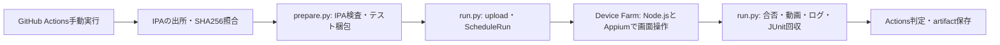

# 構成と判断理由

[E2Eの入口](README.md) / [実行手順](runbook.md) / [シナリオの保守](scenarios.md)

## 実行の流れ

トリガーは`workflow_dispatch`のみ。同repo内の実行を直列化し、poolの`maxDevices`は1〜3、1jobは10分、upload/queueを含む待機は45分。完了は15秒間隔で確認する。AWSリージョンは`us-west-2`に固定する。互換性確認済み端末ARNをScheduleRunへ固定して渡し、pool編集による実行対象の拡大を防ぐ。

テストコードと実行スクリプトは手動実行時に選んだworkflow refのSHAから取得する。IPA artifact内のスクリプトは実行しない。アプリのSHAとテスト/workflowのSHAを分けて記録する。初回は追加ID/ビルドmarkerを含むIPAが必要。

## Pythonスクリプトは何をするか

E2Eの画面操作はNode.js＋WebdriverIO/Appiumで定義する。PythonはGitHub runner上で動く実行基盤で、アプリ本体や実機上で動く言語ではない。

| スクリプト | 入力と処理 | 出力 |
| --- | --- | --- |
| `prepare.py` | IPAのSHA256・bundle ID・iPhoneOS形式を照合。`scenarios.json`を読み、npmの依存込みtarballをZIPに格納 | `input.json`、`tests.zip`。AWSアクセスなし |
| `run.py run` | 3種のupload、pool互換性確認、ScheduleRun、完了待機、割込み/失敗時の停止要求 | run ARN・状態を`run.json`へ即時保存 |
| `run.py finalize` | 未完了runを停止し、端末jobごとのログ/動画/画像/JUnitを回収。build情報と登録シナリオを照合し、今回のuploadを削除 | `run.json`の最終合否、回収artifact、Actions summary |

**Pythonである必要はない。** AWS公式SDKの`boto3`と、標準の`zipfile`/`plistlib`/`unittest`で、IPA内のbinary plist、梱包、AWS API、回帰をまとめて扱うために選んだ。代わりにCIへPython3.12とboto3の依存が加わる。アプリ本体のnpm依存や、Device Farm上のNodeテストへPythonを組み込むことはない。

Node.jsへ統一することも可能だが、AWS SDK for JavaScriptとZIP/plist処理への置換が必要になる。言語を変える場合も、入力拒否・二重Schedule防止・中断時の停止・失敗時回収・証跡照合を同じ回帰で維持する。PythonがDevice FarmやAppiumの必須条件であるとは扱わない。

## シナリオ登録と合否

`e2e/scenarios.json`を登録一覧とし、そのIDを`smoke.test.mjs`の各操作テストへ紐付ける。prepare時にID一覧をパッケージと`input.json`へ含める。Node runnerとPythonの回収側は、登録された全IDの実行を検証する。固定の「4件」という条件は持たない。

APIの結果が`PASSED`でも、端末jobの欠落/失敗、成果物回収の失敗、登録シナリオの不足・重複・skip、build/端末/runの不一致はActionsを失敗にする。WARNED/ERRORED/STOPPEDは合格にしない。AWS Test insightsは有効にせず、JUnitをCustomer Artifactsとして回収する。

## 検証する範囲

公開端末のUIスモークは、新規インストール・本人データなしを前提とする。Appium 3・XCUITest・Node24・`macos_tahoe`/Xcode27を使用し、公開iOS18以上を許可する。実版はログへ残す。WDAはdriver majorに対応するAWS提供の署名済み版を使い、不明な版へfallbackしない。

公開端末ではIPAが再署名され、App Groupsなどが除去される。**Family Controlsの認可、Picker、実Shield、一時解除、Extension callback、host kill中の期限再制限、App Groups/File Protectionの成立は合格範囲に含めない。** 未認可/利用不可の表示は正当なテスト状態だが、実制限の証明にはならない。#26/#49/#50/#52/#131/#135の実機ゲートは維持する。

実制限まで自動化する場合は専用シナリオを設計する。private device登録・対応profile/entitlement・再署名skip・検証対象アプリ・OS認可手順の実測が必要で、現在のworkflowはprivate poolを拒否する。

## 公式仕様

2026-11-12 JST確認: [iOSの再署名](https://docs.aws.amazon.com/devicefarm/latest/developerguide/apps.html)、[private端末での再署名skip](https://docs.aws.amazon.com/devicefarm/latest/developerguide/skip-app-re-signing-on-private-devices.html)、[Appiumのパッケージ化](https://docs.aws.amazon.com/devicefarm/latest/developerguide/test-types-appium-integrate.html)、[test hostと対応OS](https://docs.aws.amazon.com/devicefarm/latest/developerguide/custom-test-environments-hosts.html)、[hostのソフトウェア](https://docs.aws.amazon.com/devicefarm/latest/developerguide/custom-test-environments-hosts-software.html)、[テストspec例](https://docs.aws.amazon.com/devicefarm/latest/developerguide/custom-test-environment-example.html)、[WDAの選択](https://docs.aws.amazon.com/devicefarm/latest/developerguide/test-types-appium.html)、[成果物](https://docs.aws.amazon.com/devicefarm/latest/developerguide/artifacts.html)。
