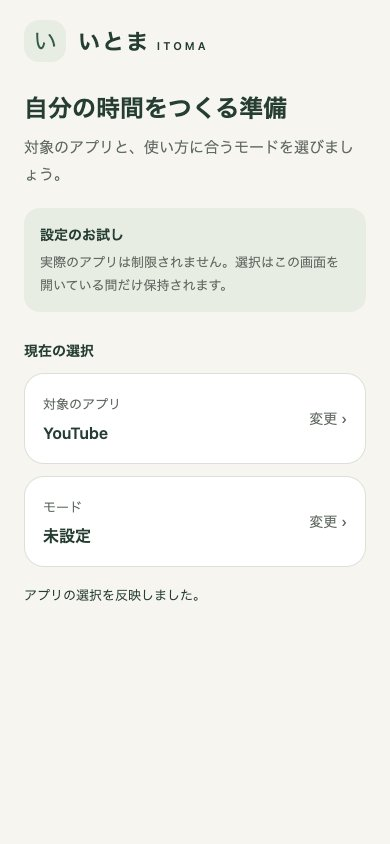
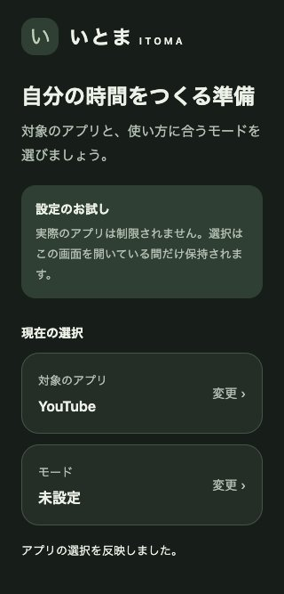
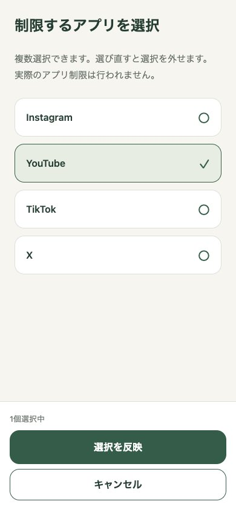
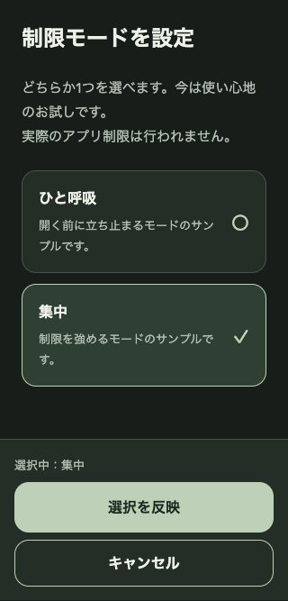

# ホーム画面へのデザイン原則適用

## 利用場面と判断

利用者が初回設定や設定の見直しをするときに、対象アプリとモードを把握し、自分で選択を変えられる画面にします。

- 大きな宣伝コピーと手順番号を整理し、現在の選択をカード内で強調しました。
- お試しであることを操作前に提示し、モックを実際の OS 制限と誤解させない構成にしました。
- カード全体を変更ボタンとし、操作可能であることを「変更」の文言でも示しています。
- 選択一覧をスクロールしても、反映・キャンセルは同じ位置に残ります。キャンセルにも52以上の高さと枠を設けました。
- 永続保存を意味しない「選択を反映」に変更し、反映・キャンセルの結果をホームに表示します。
- モーダルの独自スライド指定をなくし、動きに依存せず操作できる構成にしました。

## 検証済み

- 型チェック、lint、コンポーネントテスト2件。反映後・キャンセル後の選択と結果文言を確認。
- Chromium / React Native Web: 390×844 Light、320×667 Dark + prefers-reduced-motion。
- Web で YouTube の選択・反映、集中モードの選択・キャンセルを操作。キャンセル後はモード未設定を維持。
- 320px 幅で document の scrollWidth は320、testID付き要素の右側はみ出しなし。
- ソースの配色から計算した補足文字／背景・面・補助面、ボタン文字／強調色のコントラスト比は4.65〜9.12:1。画面全体のアクセシビリティ適合を示すものではありません。

## 画像（Web 表示。iOS Simulator ではありません）

| ホーム Light 390px | ホーム Dark 320px |
| --- | --- |
|  |  |

| アプリ選択 390px | モード選択 320px |
| --- | --- |
|  |  |

## 未検証・制約

- iOS Simulator / iPhone 実機、Dynamic Type、VoiceOver、iOS シートを閉じた後のフォーカス、OS の Reduce Motion は未検証です。
- 設定はメモリ内のみで、OS 制限・権限・永続保存の実装はありません。
- 固定した下部操作と極端な文字拡大・小さい画面の組み合わせは実機で確認が必要です。
- expo-doctor の既存の推奨バージョン不一致は別途対応が必要です。
