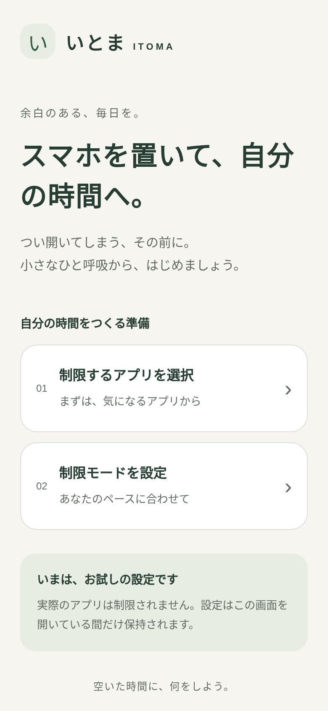
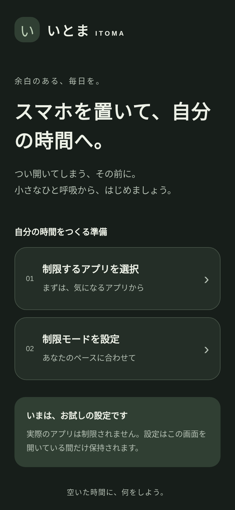

## 変更内容

Expo のスターターホームを、いとま（ITOMA）の初期ホームに置き換えました。「スマホを置いて、自分の時間へ。」と2つの設定カードを表示し、サンプルアプリの複数選択と制限モードの選択をシートで試せます。保存するとホームの要約に反映し、キャンセルでは変更を破棄します。

- React Native + Expo Router + TypeScript。ルートは Slot で表示し、スターター用タブを初期ホームから外しました。
- Safe Area、スクロール、ライト／ダーク表示、44pt以上の操作領域に対応。
- 主要な操作に testID、accessibilityLabel、役割と選択状態を設定。
- OS 制限 API・バックエンド・新しい依存関係は追加していません。

## 検証結果

- `npx --no-install tsc --noEmit`: 成功
- `npm run lint`: 成功
- Metro の iOS JavaScript バンドル生成: 成功
- Chromium / React Native Web（390 × 844）: アプリ選択・選択解除・保存・キャンセル、モード選択・保存・キャンセル、ホームの要約反映を確認。
- 320px幅: ページの横方向オーバーフローなし。ライト／ダークの画面を撮影・目視確認。
- `NODE_USE_ENV_PROXY=1 npx --yes expo-doctor`: 18/20 成功。Expo 設定スキーマと React Native Directory のオンライン検証2項目は、既存のネットワーク制限で失敗。依存関係の互換性・重複検査は成功。
- `git diff --check`: 成功

## スクリーンショット

以下は Chromium で撮影した React Native Web 表示です。iOS Simulator の画像ではありません。

| 初期ホーム | ダーク表示 | モード設定 |
| --- | --- | --- |
|  |  |  |

## 既知の制約・未検証事項

- 設定はメモリ上のモックで、ホームがアンマウントされると失われます。画面内にも説明しています。
- 実際のアプリ一覧の取得、Screen Time API、OS の制限適用は未実装です。
- Linux 環境のため iOS Simulator は未検証です。
- iPhone 実機、VoiceOver、Dynamic Type、iOS ネイティブシート／スワイプ終了、ネイティブ起動と署名は未検証です。
- 標準の docs.expo.dev は接続制限で取得できなかったため、利用可能な Expo 公式 GitHub ソースの SDK 58 と Safe Area の資料を参照しました。
