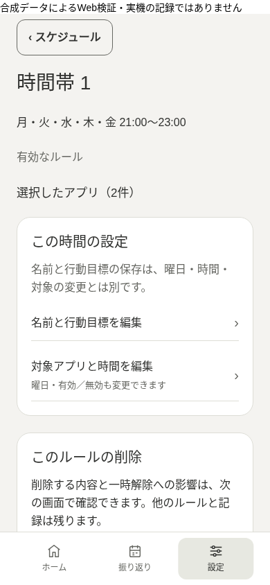
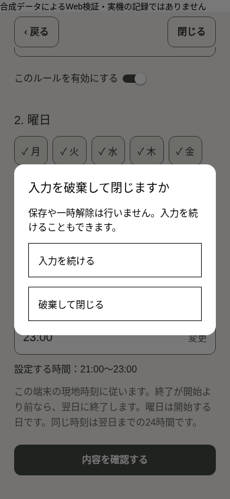
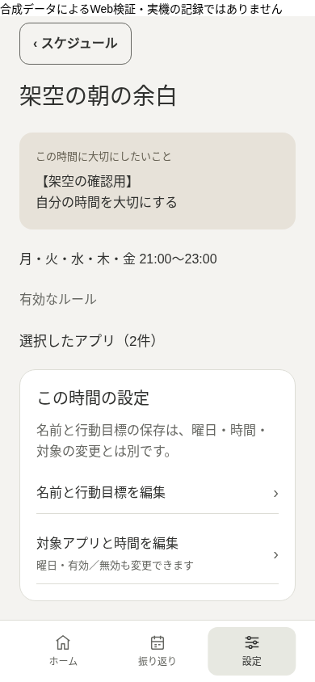
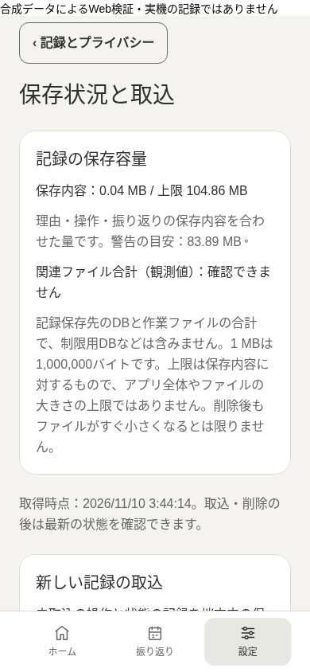
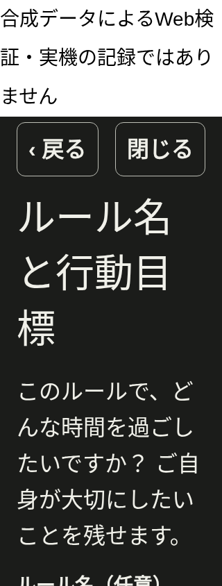
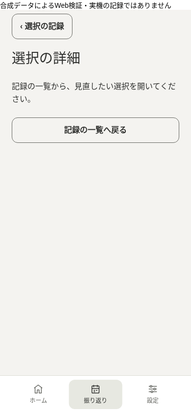

# 閲覧Stack / 作業フローの確認（#217）

**追加依頼：** 戻るを小さな‹と44ptの領域へ変更し、作業先頭も標準の左端popを使えるcard presentationへ更新。[最新の画像・6条件・入力保護の確認](compact-back/README.md)。以下は各source時点の記録で、初回の枠付き戻る画像を最新UIとは扱わない。

2026-11-16 UTC。Linux Chromiumの合成Web操作とsource/componentテスト。**iPhone/Simulatorを操作した記録ではない。** 画像のアプリ・理由・名前・目標・6900秒の集計は架空。Screen Timeの成功や制限時間の実測を示さない。

- 画面/期間/履歴の操作：productionのRouter、parser、Provider、画面に、明示した合成native portを注入。
- 通常のiOS AlertをWebで操作できるよう、`ProofDialog`でAlertの選択callbackを代行。破棄処理の成否/遷移の検証用で、native Alertの見た目やgestureを検証していない。
- 検証source：操作一式 `e6530f1`、幅/配色の6条件 `f57c749`。後者から前者の製品差分は、終了した作業のRAM returnContextを解放する2行のみ。後者の操作一式もPASS。製品の後続source `c65cdc3` は、削除preview/認可が遅れて返った際に退出済み画面から遷移しないguardと回帰2件を追加。base main `49a74f1`（PR220/固定ラベル/制限区間修正を含む）。
- `provenance.json` に合成port/一時layout/操作script/画像/製品入力のSHA256を記録。画像から実機や署名構成の一致は推測しない。

後続 `bd96590` ではRAMの帰還情報をrefで保持し、Contextの変更だけで画面を再描画しない形に整理。最終sourceで [`return-context.json`](return-context.json) / [`return-context.cjs.txt`](return-context.cjs.txt) の実Router操作（設定詳細/未編集close/warm link/内部戻り/破棄失敗/外部退出/既存保存の起点帰還）を再確認した。設定詳細と破棄確認の画像はこの再確認時のもの。

## 遷移の比較

| 操作 | 変更前 | 今回の実装と確認 |
| --- | --- | --- |
| 設定→一覧→詳細 | タブ外の画面へ進み、タブが消える | 設定Stackでタブを維持。ホーム1回、設定1回で同じdetail keyへ復帰 |
| 編集→確認→編集 | 子画面removeの破棄確認と工程内の戻るが混在 | 同じmodal内の戻りは土曜日の入力を保持。全体の閉じるだけ破棄確認 |
| 外部から設定へnavigate | 作業をblurして残すとguardを通らない | Rootのmain再利用でworkをremoveし、同じguardへ。継続は/ruleに留まる |
| 保存完了 | 常にホーム | 既存/新規は保存済み詳細、削除は一覧。解除受付はホーム→解除状況 |
| 設定→履歴→保存状況 | カテゴリと戻り先が曖昧 | 振り返り→履歴、設定→記録とプライバシー→保存状況を作る |
| 容量の読み取り | 履歴のrefreshで取得済みページを初期化 | 容量用bounded readを分離。同世代の3ページ/92件と位置を保持 |
| 詳細の直接リンク | back履歴なしならホーム | cold linkも所有カテゴリ＋論理的な親。欠落対象は一覧へ、理由本文は自動取得しない |

## Web操作結果

[`functional.json`](functional.json) と [`functional.cjs.txt`](functional.cjs.txt)。390×844、Light、Reduce Motion。

- 設定詳細→ホーム→設定でroute key不変。同じ選択タブを押しても詳細のまま。
- 未編集closeは即時。編集→確認→編集で曜日保持。closeの確認取消で入力保持。取消の合成失敗は/ruleを保持。外部navigateも同じ確認を通る。
- 既存の保存、新規の名前/目標を含む保存は対応する詳細へ。削除は一覧へ戻り、消えた詳細を表示しない。
- 終了した編集の起点を、次のwarm linkによる解除フローへ流用しない。
- 月次11月→ホーム→振り返りで11月を保持。12月→日付→11/30からのclip週→履歴→集計復帰、全期間入口のqueryリセットを確認。
- 92件を3ページで取得し、古い選択→全文→一覧の位置が一致。保存状況→振り返りでも3ページ/92件と位置が一致（数値はJSON）。理由取得中に一覧ヘッダへloading行を挿入して47pxずれる経路を修正した。
- 記録管理の全期間リンク→履歴→設定の反復100回。ループ内の閲覧Stack深さは各2。詳細/容量は正規の深さ3。Rootは共通mainを再利用する。
- 一時解除は1回だけ受付。状況画面はホーム所属。上部ホームで戻っても解除commandを再発行しない。これは合成応答でのUI/発行回数確認。
- modal内の操作可能/accessibleなタブ0、JS例外0。非選択カテゴリ/背後タブの除外をDOMで確認。native VoiceOver合格とはしない。

[`width-cold.json`](width-cold.json) と [`width-cold.cjs.txt`](width-cold.cjs.txt)：320/375/390幅 × Light/Dark。375幅は高さ667、320幅はDOM文字を200%相当に拡大（native Dynamic Typeではない）。長い架空の名前/目標を編集・保存。ヘッダの戻る/閉じるは52px、拡大時78px以上で画面上に残り、横overflowとJS例外なし。cold schedule detail→一覧→設定、選択情報のないcold reason→履歴、存在しないschedule→一覧を確認。長文保存後の画像は元のスクロール位置を保った状態。

## 画像（合成Web）

| 設定詳細と共通タブ | 全体の破棄確認（Web用callback adapter） |
| --- | --- |
|  |  |

| 新規保存後の詳細 | 記録から設定の保存状況へ |
| --- | --- |
|  |  |

| 長文・320幅・Dark・文字200%相当 | cold linkに選択がない場合 |
| --- | --- |
|  |  |

[選択の詳細](choice-detail.png) / [記録管理](records.png) / [解除状況](grant.png) / [長文保存](saved-light-320.png) / [欠落ルール](missing-rule.png)。

## N01〜N14の範囲

| ID | source/component/Webで確認したこと | 残る実機確認 |
| --- | --- | --- |
| N01〜N06 | ブランド/親ラベル、タブ所有、key/条件/期間/位置の保持、cross category正規化、100回のStack上限 | 実機の遷移感・素早い連打 |
| N07〜N08 | 工程内戻り/全体closeの区別、1回の破棄確認、取消失敗/外部navigateの保護、modal背後タブ除外 | native gesture、OS Pickerからの復帰、VoiceOver focus |
| N09 | 編集/作成/削除/名前の帰還、失敗時保持、遅い旧commit応答が新しいdraftを消さない回帰 | native書込/OS適用との実際のタイミング |
| N10 | 合成unlock1回、grant→ホームでcommandを追加しない | 実制限・期限・Extension |
| N11 | cold親階層、欠落/未選択表示、URLは静的画面名＋対象UUIDのみ | Universal Link/OSの起動条件 |
| N12 | 6表示条件、長文、戻る/閉じる44px超、Reduce Motion、DOMの背後除外 | native Dynamic Type/VoiceOver/IME/キーボード/Safe Area/ホームインジケータ |
| N13 | 実Router100往復、SDK StackRouterの100作業反復、共通Provider1組、既存のforeground/世代失効テスト | iOS RAM/購読/timer計測、kill・背景復帰・認可変更 |
| N14 | clip/全期間入口/無限スクロール/詳細位置、停止/再開/削除の既存回帰 | 実データとOSとの統合受入 |

未実機項目は #131/#135、全履歴メタデータの長期メモリ上限は #214。Stack深さの上限確認を、iOSプロセスメモリや取得済み全履歴量が常時一定という保証へ読み替えない。

## 再現と製品bundle

cleanな検証用checkoutで、`.txt`のproof layout/clients/probeをそれぞれ `src/app/_layout.tsx` / `src/qa/navigation-proof.tsx` / `src/qa/navigation-probe.tsx` へ一時コピーし、Expo Webを8774で起動する。PlaywrightとChromiumの場所はscript冒頭を環境に合わせる。製品dependenciesへの追加は不要。functional→width-coldを実行する。

最終source `bd96590` で型・Lint（警告0）・Jest 29 suites/277件・demo32件・expo-doctor20/20を確認した。doctorの初回直接接続はネットワークエラーとなり、Nodeの環境proxy設定で再実行してPASS。依存/configは変更していない。

終了後はlayoutを製品版に戻し、2つのQA runtimeを削除する。このPRの製品sourceからは注入・banner・dialog adapter・window probeを除外する。通常のiOS JS/Hermes exportはnative buildではない。最終source `bd96590` の通常iOS JS/Hermes exportとserver Web exportがPASS。両出力から今回のQA runtime固有markerがないことを確認した。bundle digestはprovenance、最終結果はPR本文に記す。
