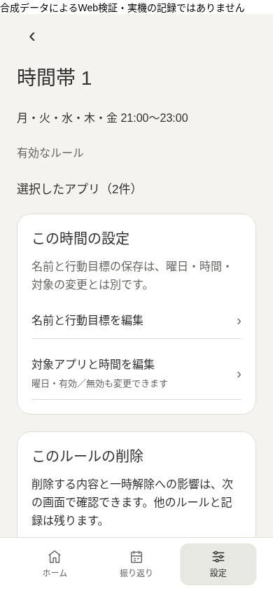
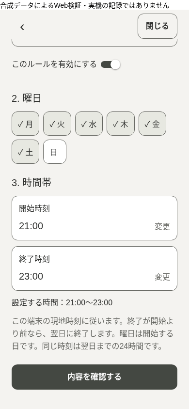

# 控えめな戻る操作と左端pop（PR226の追加依頼）

2026-11-16 UTC。本人から「左上の小さな‹＋左端スワイプ、44pt以上、戻り先の読み上げ、編集の未保存保護」を同じPRへ加えるよう依頼。製品source `e802ca1034b11fc7df060aa18bb540aeb3d06547`、直前head `9467305`。

## 変更と確認の範囲

- 通常の枠付きButtonを戻るに流用せず、共通FlowScreenの装飾なしPressableへ変更。左上の見た目は‹のみ。実際の領域は44×44pt以上、記号は固定30pt（文字の代わりのアイコン）、設定トップに戻るは置かない。
- 外側のbuttonに「スケジュールに戻る」「設定に戻る」等を設定。内側の記号は読み上げ対象にしない。親を特定しない工程は「前の画面に戻る」。保存/削除など本文の操作の見た目は変えていない。
- Expo58/Router58.0.30の[Stack options](https://docs.expo.dev/router/advanced/stack/)、[Modal](https://docs.expo.dev/router/advanced/modals/)、配布型定義、react-native-screensのiOS実装を確認。UIKitのfullScreenModalは通常のpush controller列と異なるため、先頭の編集画面も標準popを使えるRoot card presentationへ変更した。
- Root/閲覧Stack/作業内Stackで横方向・gesture有効・fullScreenGesture無効を共有。iOS26以降の全幅swipeも明示的に無効化し、左端に限定する設定。独自のPanGesture、フローティングボタン、別の履歴、timerは追加しない。背後タブの除外と既存のRoot退出guardは維持する。
- 工程内の戻りは入力保持、フロー全体からの退出はボタン/POPとも同じ未保存確認。取消/失敗では閉じない。実際のiOS gesture認識・途中キャンセル・native animationはこのLinux環境では未確認。

## 合成Webの操作

[results.json](results.json) / [capture.cjs.txt](capture.cjs.txt)。production Router/Provider/parser/画面に前回と同じ合成native portを注入。Alertの選択はWeb用adapterで操作する。**実機の画像やOSの制限成功ではない。**

320/375/390幅 × Light/Darkの6条件PASS。375幅は高さ667、320幅はDOMの文字200%相当（native Dynamic Typeではない）。記号は文字拡大の対象から除外。

1. スケジュール詳細をcold linkで開く。戻るの見た目が‹のみ、border0、透明背景、実領域44×44pxであることを測定。
2. 「スケジュールに戻る」→一覧、「設定に戻る」→設定トップ。トップの戻る要素0。
3. 未編集の時間ルールから‹で戻ると確認なしで詳細へ。
4. 土曜日を編集→確認→`router.back()`で入力へ。確認dialogなし、編集値を保持。
5. 先頭の編集画面で‹→入力継続、`router.back()`→入力継続の両方で確認が働き、編集値を保持。
6. POP後に明示的な破棄を選んだ場合だけ詳細へ帰還。作業中のタブ0、cancelCandidate1回、policy/grant write0、横overflow/JS例外0。

`router.back()`はnativeのswipeによるPOPと同じRouter側のremove/guard経路の確認であり、実際の指のgestureの代用合格とはしない。Jestも新しいヘッダボタンとremove要求の両方で1回の未保存確認、継続時の保持、承認後だけ破棄を確認する。

| 詳細：通常の枠付き操作から分離 | 編集：戻るは小さく、タップ領域を確保 |
| --- | --- |
|  |  |

[設定トップ（戻るなし）](settings-root.png) / [Dark・320・文字200%相当](editor-dark-320.png) / [POPに対する確認（Web adapter）](native-pop-guard.png)。拡大した編集画面の画像は本文をスクロールした状態。ヘッダは本文とは独立して残る。

## 自動チェックと再現

型、Lint警告0、Jest **29 suites/278件**、demo32件、expo-doctor20/20を確認。Swift/native/schema/依存/configの変更なし。通常のiOS JS/Hermes・server Web exportとSHA256は `provenance.json` に記録する。JS exportはnative buildではない。

cleanな検証用checkoutで `proof-layout.tsx.txt` / `navigation-probe.tsx.txt` を `src/app/_layout.tsx` / `src/qa/navigation-probe.tsx` へ、親ディレクトリの `proof-clients.tsx.txt` を `src/qa/navigation-proof.tsx` へ一時コピー。Expo Webを8774で起動してcaptureを実行する。Playwright/Chromiumの場所はscript冒頭を環境に合わせる。終了後は製品layoutへ復元し、2つのQA runtimeを削除する。製品dependenciesには追加しない。

## 残るiPhone確認（#131/#135）

- 設定トップに戻るがなく、下層は‹/左端のスワイプで同じ親へ戻る。
- 編集先頭で変更してから‹と左端スワイプを試し、継続なら全文/曜日/時間を保持し、破棄の承認でだけ起点へ戻る。
- 確認→入力のスワイプは未保存値を保持する。未編集の先頭では不要な確認を出さない。
- スワイプを途中で戻した場合の画面・フォーカス・Stack、iOS26以降の画面中央の横操作、OS Picker/キーボードからの復帰。
- VoiceOverの親ラベル、記号の二重読みなし、最大Dynamic Type、Safe Area、44ptの操作範囲。実機SHA/JS bundle・native構成を記録する。

以前のN01〜N14と100往復の証跡は[親の記録](../README.md)のsource時点のもの。今回の画像をiOSのgesture成立・メモリ計測へ読み替えない。
