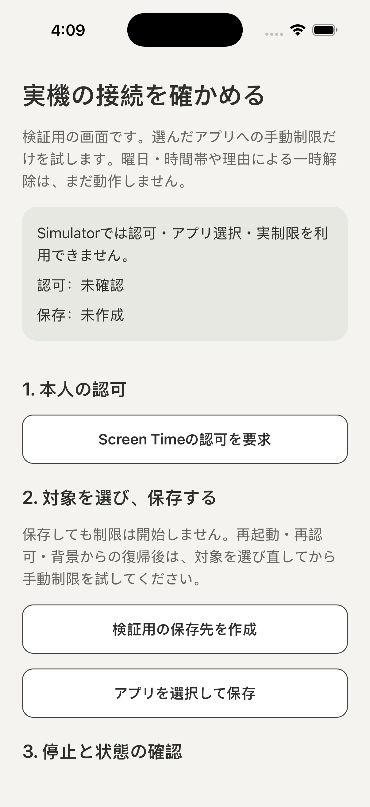

# 限定手動PoCのSimulator検証記録

対象: [PR #106](https://github.com/kzk-maeda/itoma/pull/106) / [#105](https://github.com/kzk-maeda/itoma/issues/105)。**認可・Picker・選択保存・手動Shieldのコードを含むビルドで、Simulator上のread-only接続と検証画面への到達を確認した記録**。実アプリ制限や実機の成功ではない。

| 項目 | 確認した値 |
| --- | --- |
| requested/source/native/JS/workflow SHA | すべて `3071f97d1055af4253efec4a2be8823d8f7b6b4e` |
| QA run / build ID | [42387752357](https://github.com/kzk-maeda/itoma/actions/runs/42387752357) / `42387752357-1` |
| quality CI | [42387744213](https://github.com/kzk-maeda/itoma/actions/runs/42387744213)、同head成功 |
| PR #106 merge | `c67fc68db78283c26e9a0c3a721ae0645911ccd1`。test headとの差分は既存のroot README/PR95証跡だけで、製品コード/構成/QA scriptは一致 |
| artifact | [13580828441](https://github.com/kzk-maeda/itoma/actions/runs/42387752357/artifacts/13580828441)、1,371,494 bytes |
| ダウンロード済みZIP SHA256 | `4f27097b81bf7e3a76b5a72e7388fb7b18f222fb380fd2e5ebe217a1f429b649`。GitHub metadata値と一致 |
| native config fingerprint（JSON記録値） | `8b6967e396bbac6c6e054c3202b6f8536e968c8e7176cbf558ffe11572353bc6` |
| JS bundle SHA256（JSON記録値） | `7bb62c4b84294f505d7c40c5de648fcd857f194fe74ae8a4f058b1af2dae98fe` |
| 構成 | Release / iphonesimulator / arm64 / signing disabled / `com.example.itoma` |
| ツール | Xcode26.6 (`17F113`) / Swift6.3.3 / SDK26.5 / CocoaPods1.17.0 |
| 専用Simulator | iPhone17 Pro / iOS26.5 |
| Mac Swift Testing | Core62 / Storage88 / Control80、計230件 |
| TypeScript/Lint/Jest/QA tools/demo/doctor | PASS / PASS / 24件 / 16件 / 20件 / 20チェック |
| 結果 | status/cleanup pass、全17stage pass |
| 実行日時（原本UTC） | 2026-11-07T15:44:09.344Z〜16:09:27.559Z（JST 2026-11-08 00:44:09〜01:09:27） |

[result.json](result.json)はartifactの原本。2026-11-08 JSTに接続済みGitHubの正式artifact取得APIでダウンロードし、実ZIP digest一致後、path traversal/symlink/過大entryを拒否して展開した。全SHA一致・17stage・status/cleanupを検査し、独立レビュアーも再確認した。ZIP/PNGのhashは実バイトから計算した。config/bundleのhashは**JSONの記録値の確認**であり、app binaryからの再計算ではない。binary、署名付きURL/query、credential、全ログは保存しない。

## 何が確認できたか

- 新規CNG/CocoaPodsの本体ビルド・install/launch、Coreの5分/0分検証、JSON文字列wireのJS→Swift往復が成立した。
- QA用JSで`router.replace('/native-poc')`へ移動し、遷移先の画面自身がread-only snapshotを取得して、Simulator利用不可/未認可/未保存/対象なし/idle/nullを確認した後にだけPASS markerを出した。
- 下の原本画像にPoCの見出し、Simulator利用不可、認可未確認、保存未作成、認可/選択保存の入口が読める。OSの「Open in itoma?」確認ダイアログはない。画像目視は独立レビュアーも実施した。
- 専用Simulatorのshutdown/deleteが成功し、既存deviceは操作していない。

## Dark切替は未成立

`simctl ui appearance dark`はexit0だったが、[Dark指定後の原本画像](native-poc-dark.png)もLightのままで、両PNGの実SHA256は同じだった。

`0d19def89d0f64fecbc5aaf0e33756a3160fb8d785ad2fd8475040c31e97c8da`

よって、**このrunでiOS Darkの成功を主張しない**。OS側の実trait、React Nativeのscheme、描画反映、cold launchをまだ切り分けておらず、原因は未確定。WebのLight/Dark成功と区別し、[#10](https://github.com/kzk-maeda/itoma/issues/10)の残件として追跡する。QA jobのPASSはビルド/往復/画面ready/画像生成/cleanupの判定で、画像内容の全UI受入ではない。

旧head `5abfd76` / run42384535511はビルド/往復が成功したが、URL起動確認で画像が止まっていたためPoC画面の表示証拠には使わない。現runはその問題を修正した後の別buildであり、旧結果を付け替えていない。

## 実機と製品フローの残件

本人の実機は **iPhone SE第3世代 / iOS27.0.1 / Xcode27.2**。Apple Developer未登録で既存Program Teamもなく、実機操作は本人が担当する。Family Controls対応Team/profileの用意が外部条件。登録/購入/署名変更/申請/配布は実行していない。

実機の認可・拒否・取消・Picker・opaque tokenの有効性/保存保護・Shield適用/停止、再起動、VoiceOver/最大文字拡大/100往復は未検証。曜日予定・理由の一時解除・OS期限後再制限・App Groups/Extension・製品ホームの保存接続は未実装/未接続のまま。Simulator26.5の結果を実機27.0.1へ転用しない。

次の実機手順は[限定実機PoC](../../ios-device-poc.md)、外部条件は[#8](https://github.com/kzk-maeda/itoma/issues/8)、採否基準は[#26](https://github.com/kzk-maeda/itoma/issues/26)を参照する。この文書の追加commitを新しいnative buildとみなさない。親Issueをこの限定PoCだけで閉じない。
