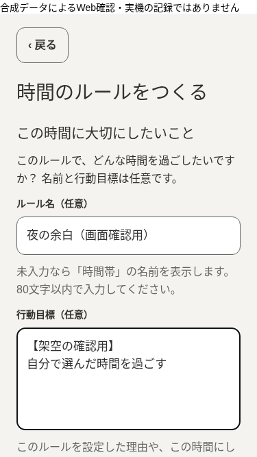
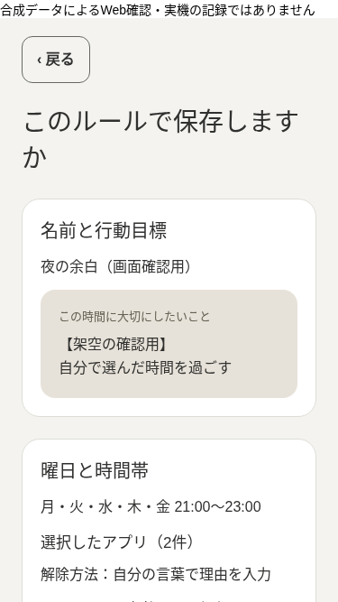
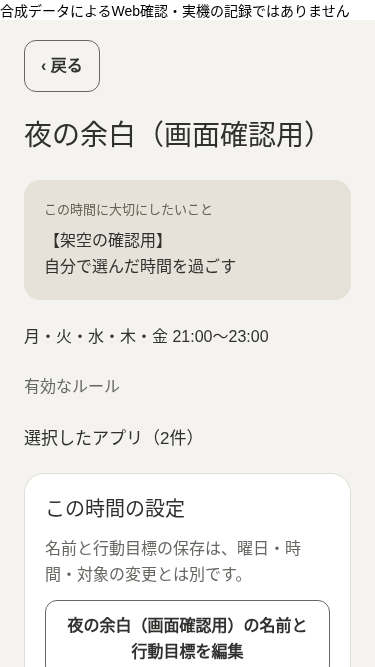

# 設定から追加するルールの名前と行動目標（#216）

2026-11-16 JST。base main `6fad80d6c6852bebc58a45f935a7e7b4fe89c915`。本人の「設定から新規追加した際に名前/目標の入力動線がない」という報告を修正した。

新規追加画面で任意の名前/行動目標を入力し、アプリ・曜日・時間帯と一緒に最終確認する。確認から戻っても全文を保持する。共通のField/Graphite/FlowScreenを使い、目的→条件→確認/保存の順で本人の時間の使い方を先に考えられるようにした。初回設定と既存ルールの個人文編集は維持する。

## main統合後の再検証（2026-11-16 JST）

main `341004cf1e92f7dc6fe836c2174745f44820ea49`（#218の確認中/取得失敗の分離）を取り込み、`rule-details.tsx` と `main-flow.test.tsx` の競合を解消した。新規追加の名前/目標入力・RAM保持・private再保存と、mainの確認中表示・取得失敗後の再試行を両方維持する。

新規追加画面もProviderの`ruleDetailsState`を使い、再確認中は補足文のみ、実際の取得失敗後に警告/再確認ボタンを表示する。確認中は確定を無効にし、入力を消さない。背景復帰→確認中→正常/失敗→明示再試行の2ケースを追加し、両側の既存テストも保持した。

- PASS：型チェック、Lint、Jest **26 suites/261件**、demo tools **32件**、expo-doctor **20/20**、diff check。
- 以下の画像・21画像digest・iOS JS/Web exportは、初回head `5a0d7449772d426a9cc2daa03c22376292112893` の検証記録。統合後のsourceへ実施済みとして付け替えない。今回の再検証は上記のローカルチェックで、実機/Simulator/画面画像の再取得は行っていない。

## 初回実装時の検証（5a0d744）

- PASS：型チェック、Lint、Jest **26 suites/246件**、demo tools **32件**、expo-doctor **20/20**、diff check。
- PASS：通常構成のiOS JS/Hermes export、server Web export。一時QA runtimeとWebのstatic設定を戻した構成を使い、QA markerが通常bundleに入らないことを確認した。これはnative build/Simulator/実機検証の成功ではない。
- PASS：追加→入力→確認→編集へ戻る→入力保持→確定→ホーム/設定表示。空欄許可、80/1000 UTF-16単位上限/NUL拒否、取消の確認、private保存失敗/競合、連打をcomponentで確認した。
- PASS：本文をpolicy入力へ渡さず、新しいルールだけに保存する。保存の応答にsnapshotがなくてもpolicyを再作成せず再読込できる。後続revisionの別ルールへ自動で文章を保存しない。
- PASS：Linux Chromiumで320/375/390px × Light/Darkの6条件。375pxは高さ667、320pxは文字200%、Reduce Motion設定下。全条件で入力→確認→戻る→保存→設定での表示まで操作した。Darkの3条件ではprivate書込を一度失敗させ、全文保持→現在内容確認→文章だけの再保存を実行。policy commitは各1回、private書込は通常1回/失敗時2回。横overflow/JS例外なし。

[操作結果](results.json)、[source/bundle/画像digest](provenance.json)、[再現script](capture.cjs.txt)。21画像のdigestを保存し、代表5枚を本ディレクトリに収録した。すべて架空の文章による合成応答で、実機の個人データではない。

| 入力 | 確認 | 保存後の設定 |
| --- | --- | --- |
|  |  |  |

[失敗後の再保存入口・Dark](retry-dark.png)、[320px/文字200%・Dark](editor-dark-320-large.png)。大きい文字ではスクロールして入力/操作へ進む。

## 保存と復旧の境界

時間のルールと名前/目標は既存の別API/DBへ保存する。新規rule IDは成功応答の直後のpolicy revision（基準+1）、基準のrule ID集合、唯一の追加ID、入力した条件から検査する。一意に確認できないときは入力を保持して再読込し、作成commandや別ルールへの書込を繰り返さない。

private保存だけ失敗したときは、作成済みUUIDへ結び付けた全文をRAMに保持し、既存の個人文編集画面で現在内容を確認して明示再保存する。再試行にpolicy/OS予定の操作は使わない。破棄では保存済み時間ルールが残ることを伝える。文章はURLへ渡さず、共有Rule/Extension/履歴へ追加しない。

未保存文章のRAM保持は強制終了後の復元を保証しない。初回設定の永続draftとは分ける。OS反映自体の失敗/不明は既存の結果確認に従い、private保存をOS成功の証明に使わない。

## 合成Webの隔離と未検証

[一時client](proof-client.ts.txt)は既存のproduction bridge parser/Providerへ架空native portを注入し、[一時layout](proof-layout.tsx.txt)から同じ製品routeを操作した。ブラウザー配信時だけWeb出力をstaticにし、通常のapp.json/RootLayoutへ復元して一時runtimeを削除してから最終チェックと通常exportを行った。Swift/native/schema/依存/configの最終差分はない。

DESIGN原則1/4/5、U07/P07、UI07/UI21〜26/UI35〜37。新しいtimer/購読/画面pushの反復を追加していない。iOSの実キーボード/日本語IME/最大Dynamic Type/VoiceOver/戻るgesture、実際のScreen Time制限・private DBのFile Protectionは未検証。#131/#135の実機QAで、対象PRのJS source/SHA・実際のbuild ID/構成を記録して確認する。

実機では「設定→スケジュール→追加→任意の名前/目標→確認→戻る→保存→ホーム/設定」の順で入力と復元を確認する。未入力、取消、長文、再起動後の保存済み表示も確認する。Web文字拡大はDynamic Typeの代用ではない。
