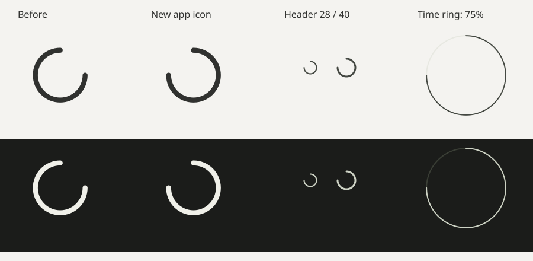

# OPEN CIRCLEの向きを残量リングへ揃える

2026-11-20 JST / #251。本人が左上の開きへの統一を承認。元の比較ボードでは右上が開いていたが、残量75%の時間リングに合わせ、通常/Darkアイコンとヘッダーロゴを左右反転した。

上段Light、下段Dark。左から変更前のアイコン、新アイコン、ヘッダーマーク28/40px、残量75%のリング。**これはSVG素材の比較画像で、アプリ/Simulator/実機のスクリーンショットではない。**

- 変更前はbase `48170566fbb4ff78014255d267b33c31da0e3489` のSVG。
- 新アイコンは現SVG原本をコンパイル。ヘッダーの列はOpenCircleの実パスを28/40pxで描画。
- 右端はPeriodRingと同じviewBox224・半径104・線幅3、12時起点の時計回りのdash array、残量0.75の式で描画した模式図。実コンポーネントのUI検証ではない。
- アイコン/ヘッダーは `M 20 5 A 15 15 0 1 1 5 20`。12時→右→下→左の270度の弧になり、開きは左上。マークは固定で、時間によって変化しない。
- iconにはtext色、header/ringにはaccent色を使い、既存のGraphiteの役割を維持。

## 確認結果

- Light/Dark SVGとOpenCircleのパス一致。
- 生成PNGは1024×1024・sRGB・RGB/不透明。北西の円弧上が背景、北東の円弧上が描画色であることも画素で確認。
- 比較画像と原寸PNGを目視。28/40pxでも開きが残る。
- 一時コピーでScreen Time opt-inの `expo prebuild --platform ios --no-install` を実行。AppIcon asset catalogの通常/Dark画像は元PNGと全画素一致。Darkの生成画像にalphaチャンネルはあるが全255。
- Debug/Releaseとも `ASSETCATALOG_COMPILER_APPICON_NAME = AppIcon`。初期expo.iconへの参照なし。
- 既存のPeriodRing/残時間計算に差分なし。
- 型/lint/Jest（29 suites / 280 tests）/demo tooling（32 tests）PASS。
- expo-doctorは18/20。exp.host/React Native Directoryの外部接続に失敗。SDK58公式資料の取得も環境proxy403。今回のアセット生成とCNG確認はインストール済みSDKで実行。

ソースhash・PNG hashとCNG結果は[assets.json](assets.json)。PNG再生成は[ブランド資料](../../brand/README.md#端末ビルド用アセット)のコマンドを使用。npm依存・app config・native実装を変更していない。

## 未検証と端末への反映

Linux / Node24 / Expo58での素材・CNG確認まで。Xcode build、Simulator/iPhoneの表示、実際のiOSマスク/Tinted、VoiceOver、archiveは未検証。今回、文字・操作・読み上げ属性・モーションの変更はないが、画像の確認からnative合格とはしない。残る実機/ストア用画像のゲートは親#184で管理する。

マージ後、従来の署名・Screen Time/App Groupの環境を維持してprebuild・端末向けに再ビルドし、新しいnative binaryをインストールする。Expo Go/Metroリロード/OTAだけでOSホームのアイコンは置き換わらない。mainマージ、署名、配布、デモ再配信はこの作業で行っていない。
