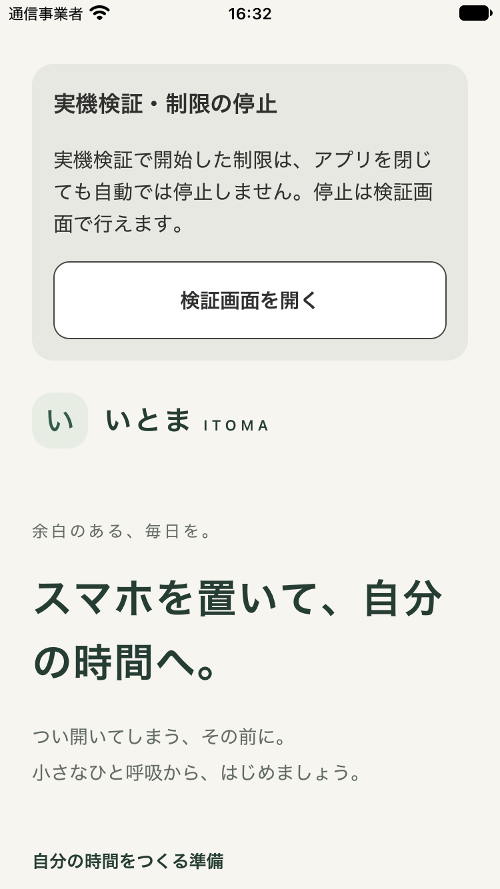

# PoCホーム復帰導線の検証

対象: [#109](https://github.com/kzk-maeda/itoma/issues/109)。確認日: 2026-11-08 JST。

## 変更と根拠

アプリ終了後に制限が残り、ホームから停止画面へ戻れない問題に対し、PoCフラグ付きiOSビルドのホーム上部に復帰入口を追加。状態取得や認可/DBの成功を表示条件にせず、入口自体は画面遷移だけを行う。停止は既存PoC画面で本人が要求する。往復は両方向replaceで履歴を積み上げない構成。通常ビルド/Webの入口は非表示。

DESIGN.md原則1/3/4/5、U07、UI22/UI23/UI24/UI25の限定範囲を適用。本人の次のタスクは検証用制限の停止なので、ブランド/モック操作より先に説明と復帰ボタンを配置した。GraphiteColors/Spacingを再利用し、最小高さ48pt、本文16pt以上。既存ホームのお試し設定と実機PoCの状態を混同しない文言にした。製品のホームやOS制御へ接続した意味ではない。

## 対象コードと構成

- テスト・JS/nativeビルド対象: `7cc39d7b24656771e2b31100b3a817096c5784ea`。後続の証跡追加コミットはdocsのみ。
- SDK58 / Node24.22.2 / Xcode27.2 / CocoaPods1.17.0。
- 専用checkoutのapp.jsonだけを、本人指定Teamと承認済みbundle ID `com.kzk-maeda.itoma.poc` に変更。Teamや署名キーをcommitせず、ソースの既定com.example.itomaは維持。
- app.json SHA-256: `22d1dd1aa3823df5e30c53215aa9d7df8f9a44608df5547ac1be485964c9886f`。`ITOMA_SCREEN_TIME_POC=1`、native smoke=0、JS/nativeのPoC構成を一致させた。
- 以前の実機build `bdcf5e0b-3ee2-4f08-8399-f5b08b72592c` は、今回の入口を含まないため新コードの検証に使わない。

## チェック結果

型チェック・lint・Jest（6suite/29件）・demo（20件）・iOS tools（16件）・expo-doctor（20/20）は成功。新しい回帰テストはPoC iOSホームの入口とreplace遷移、通常/無効フラグ/Webで非表示を確認した。Swift/entitlement/native moduleの実装変更はないためSwift packageテストは今回再実行していない。

### 実機向けビルド（操作試験とは別）

- Release / iphoneos arm64 / 開発用自動署名: PASS。
- build ID: `bea1b043-d3fd-45cd-9d7f-afa7e494de22`。
- JS bundle SHA-256: `aa846b6b12f46037c3b1a1470f919dba2007f7d69ceb8c1baa9f72f3b1524dc6`。
- アプリ署名の検証: PASS。profileのTeam・Bundle ID・Family Controls・development・対象端末、実アプリのentitlement一致をすべて確認。
- **新ビルドの実機install/起動/ボタン操作: NOT RUN**。本人が端末を外したため、再接続後に実施する。古い実機の成功を新しい導線の成功へ転用しない。

### Simulator・表示

- iPhone SE第3世代 / iOS27.2 / Release / unsigned: build・install・launch PASS。
- build ID: `1235a77e-0a48-46d1-9f89-c598af9d8a5a`。
- JS bundle SHA-256: `9208164c72a789fca891543813064c47ae4fd8b7a060ef7804f03dc9c772ceb0`。
- 375×667pt / Lightで、入口の見出し・説明・ボタンが最初の画面内に表示され、文字が切れないことを画像で確認。
- 実際の認可・Picker・ShieldはSimulatorで無効。画像だけで押下や実機停止成功とは扱わない。

## アクセシビリティと未検証

- UI22: SEサイズの初期表示のみ確認。最大文字拡大・長文・キーボードは未検証。
- UI23: 通常状態の文字/背景コントラスト計算はLight 10.60/13.08、Dark 9.55/12.49。ボタン境界はLight 9.33、Dark 9.27。画像はLightのみ。iOS Dark表示の既存残件は#10で追跡し、計算だけで実表示を合格にしない。
- UI24: ボタンrole・hint・見出しを実装。VoiceOverのフォーカス/読み順の実操作は未検証。
- UI25: 両方向replaceで履歴を増やさない構成。往復100回、実機gesture、Reduce Motionの実操作は未検証。新しいtimer/購読は追加していない。

## 再接続後の確認

1. 新しい実機用buildをインストールし、ホーム上部の入口から検証画面へ戻れることを確認。
2. 本人が対象を選び直し・保存・手動制限→ITOMA終了→アイコンから再起動。
3. 外部deep linkやMac操作を使わずホーム→検証画面→停止へ進み、選び直さず停止できることと対象アプリの解除を本人が別々に観測。
4. アプリ終了とiPhone本体再起動/オフライン/認可取り消しは別の試験として記録する。単回成功でMP07全体や#8/#12/#13/#26を閉じない。

詳細の公開用metadataは[result.json](result.json)。raw log・profile・端末識別子や秘密鍵は含めていない。
