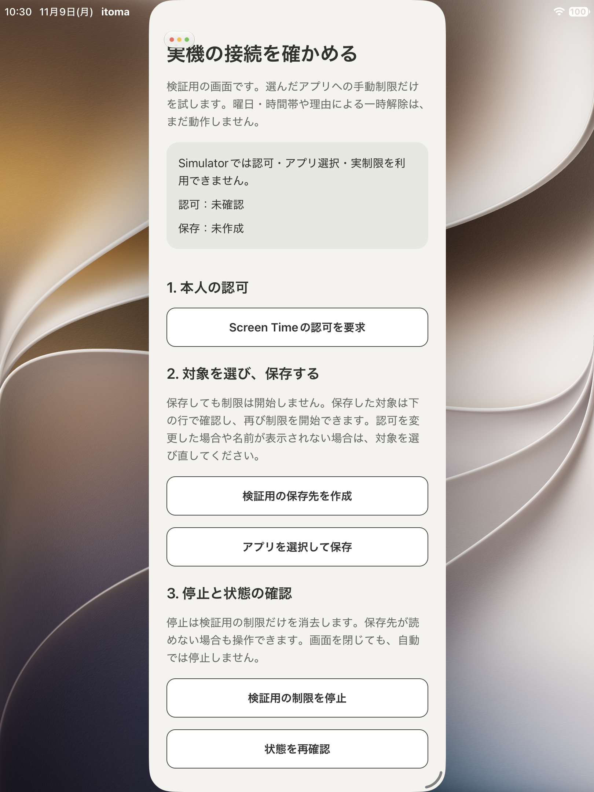

# 保存対象の表示・確認後の再制限

関連: [#119](https://github.com/kzk-maeda/itoma/issues/119)。確認日: 2026-11-09 JST。

## 対象と構成

- コード/JS/nativeのビルド対象: `3dfa7fea55d04218438d63949c7b84e3243d4297`。以後の証跡追記はdocsのみ。
- SRE05 / iPad第9世代 / iPadOS27.2。既存のiPhone向け構成による互換表示で確認し、iPad専用UIの受入とはしない。
- Release / iphoneos arm64 / 開発用自動署名 / PoC opt-in / native smoke=0。
- build ID: `2dc03893-6516-414f-9fa6-6e844c07d67a`。
- JS bundle SHA-256: `67246860d8a96aaf851a369b55a489d2c7b04fc826acdff944dedeafc279ba40`。
- ローカルapp.json構成SHA-256: `22d1dd1aa3823df5e30c53215aa9d7df8f9a44608df5547ac1be485964c9886f`。
- 本人承認の別Bundle ID `com.kzk-maeda.itoma.poc` とTeamはローカル設定だけ。commitへ含めず、Team/端末識別子、raw profile/log、実アプリ名・tokenをこの記録へ載せない。

## 自動チェック・CLI確認

- PASS: TypeScript、lint、Jest（7suite/56件）、demo、iOS tools、expo-doctor。
- PASS: Swift/native viewを含む新しい実機用ビルド、署名検証、profile/実entitlementのTeam・Bundle ID・Family Controls・development・SRE05一致。
- PASS: データを消去せずSRE05へ更新installし、OS起動・プロセス動作をCLIで確認。
- Swift packagesは未変更のため、package単体テストは今回ローカルで再実行していない。native lifecycle/OS APIの全分岐をJestやコンパイルが検証した意味ではない。

## 本人による実機観測

新しいbuild更新後、本人に「保存行のアプリ名・アイコン確認→保存した対象を確認して制限→native Pickerで対象確認→制限を開始→実アプリで制限確認→検証用制限停止」を依頼し、**「実機確認OK」**と回答を得た。

- アプリ名/アイコンの表示: PASS（本人報告）。
- 保存した対象の確認後の再制限: PASS（本人報告）。
- 対象アプリの制限・停止後の解除: PASS（本人報告）。
- 単回の案内手順に対する本人確認。agentが画面を直接観測した証跡ではなく、旧buildやiPhoneの結果から転用したものでもない。停止までの報告として試験用制限は解除済みと記録。

## UI・プライバシー

対象表示はAppleのLabelをnative内だけで描画し、RN propsはSelectionRef、eventは高さだけ。認可/停止後の再読込で表示を更新し、nativeのDynamic Typeの高さを数値で反映する。既存のGraphiteColors/Spacingとminimum48ptの操作を再利用。UI21/22/23/24/25/26、DESIGN原則1/3/4/5の限定範囲。

実際の選択アプリ名を含む画像は取得・公開しない。SimulatorはOS操作を無効化しており、保存された実対象のLabel/Picker/Shieldの成功証明には使わない。Simulatorの画像・構成は後述の限定範囲で別に記録する。

## 追加の本人確認（2026-11-09）

PR #121マージ後のチャットで、同じSRE05の継続試験として次の回答を得た。build更新の報告はなく、上記buildを対象とする継続報告として記録する。新たなbuild照合やagentの画面直接観測は行っていない。観測時刻は未取得で、日付は報告日のJST。

| 確認 | 本人報告 | 範囲・注意 |
| --- | --- | --- |
| 1. 保存対象確認Pickerのキャンセル | OK | 保存内容・制限状態が変わらない案内手順への回答 |
| 2. iPad本体再起動・オフライン復帰 | OK | 保存対象の確認・停止後の解除。初回ロック解除前やファイル保護属性の検証とは別 |
| 3. 認可取消→ITOMA復帰→再許可 | OK | 認可なし反映、再許可だけで自動制限しない、新規選択、制限・停止の案内手順 |
| 4. ITOMA終了中の認可取消→復帰→再許可 | 保存行に課題、それ以外OK | 以前の対象は復元されず新規選択が必要。「保存した選択N」の行だけが蓄積。制限・停止等の残りの案内動作はOK |
| 5. 文字拡大・VoiceOver・Dark表示 | すべてOK | 案内した保存対象の識別、確認・キャンセル・停止への到達の範囲。最大文字サイズ・長い名前・全読み上げ順の詳細測定は未取得 |

4の手順は「ITOMA終了→設定で許可オフ→ITOMA起動→アプリ内から再許可」。**取消と再許可の両方をプロセス停止中に完結した試験ではない。** 取消を見逃すすべての経路や旧tokenの有効性を保証しない。

## 発見事項と実装agentへの引き継ぎ

本人は「過去に選択したアプリ設定も残っていないが、選択した形跡（保存した選択Nが蓄積されている）だけ残り続けている」と報告。これは画面で対象を確認・復元できなかった観測であり、DBやtokenの物理削除を直接確認したものではない。

[保存行の表示・再選択・整理方針 #123](https://github.com/kzk-maeda/itoma/issues/123)で追跡する。状態表示・再選択時の置換・本人による削除などの比較は未決定で、このQA記録で自動削除を採用しない。

- 通常操作の限定PoC確認はひと区切り。製品接続、全PoC合格、設計採用と同一視しない。
- #119に結果を集約し、既存handover #103から参照する。#12/#13の本体接続、#118の設定再開では#123の判断を確認する。
- 最新main、#20、各Issueの依存と採用済み設計を再確認する。#48〜#52のExtension・共有DB・期限後再制限は今回の成功の範囲外。
- `docs/development-workflow.md`の条件が揃った末端IssueだけをReadyとする。本記録からCloudの実機アクセス・署名権限・自動実装起動を推測しない。

## 未検証・残件

- プロセス停止中に取消と再許可の両方が完結するなど、観測できない認可変更・無効tokenの全経路。
- 最大文字サイズ・長い実アプリ名・VoiceOver順序等の詳細、往復100回・3回反復・長時間操作。
- 初回ロック解除前を含むFile Protection、DB読取不可/空/破損/将来schema fixtureでの保存失敗と停止。
- 製品の予定/Extension/期限後再制限や全PoCの採否。通常操作の本人確認から合格としない。

詳細metadata: [result.json](result.json)。[限定PoC提案](../../system/poc-saved-targets.md)を参照。

## Simulatorの表示確認

- iPad第9世代 / iOS27.2 / 現行iPhone向け構成の互換ウィンドウ / Light。
- build/install/launch/初期画面到達: PASS。署名なし、native smoke=0。
- 対象source: `3dfa7fea55d04218438d63949c7b84e3243d4297`、build ID: `52080afe-4822-4708-9ac3-0216333a04bb`。
- JS bundle SHA-256: `afc47bf70bef94bff2a3abac8875af84d8de251b156f0e9f2f6bcd968d280da3`。
- `devicectl device process launch --payload-url`で自作Simulatorの検証画面へ直接起動し、URL確認ダイアログがないこと、初期の説明・Simulator利用不可・保存未作成の表示を画像で確認。
- 実アプリ名/保存データは含まない。画像は初期画面の表示だけであり、保存行のApple Labelや実機Shieldの成功証明にしない。保存対象の表示・再制限・停止は上記の本人確認として別に記録。

