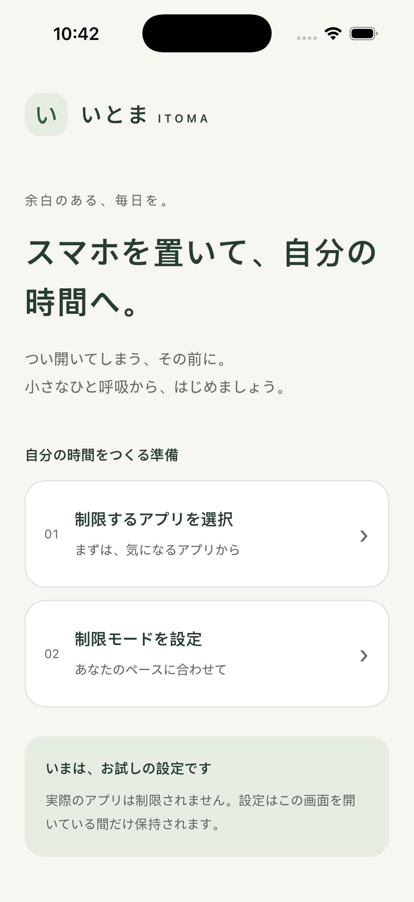

# PR #95 Simulator証跡の取得・確認

[#102](https://github.com/kzk-maeda/itoma/issues/102) / [引き継ぎ #103](https://github.com/kzk-maeda/itoma/issues/103)。2026-11-07 JSTにGitHub接続の正式な`download_workflow_artifact` APIからZIPを取得し、下記digestと一致することを確認して安全に展開した。CLIの配信先CONNECT403は残るが、接続済みGitHubツールによる取得は成立した。環境設定・proxy/TLS・署名・配布は変更していない。

**これは旧PR #95のビルドを後から確認した証跡。現在のコードのnative buildではない。** 後続のSwift/UI/config変更をこの結果で検証済みにしない。

| 項目 | 確認した値 |
| --- | --- |
| テストsource/native/JS SHA | `324c9056b7bdc182b23c8db815d4897a8825f34c` |
| PR #95 merge後main | `fdad5d6a46a8b1eca90c3803b8ea9272b56d4165`。build対象は上記head |
| QA run / build ID | [42363397873](https://github.com/kzk-maeda/itoma/actions/runs/42363397873) / `42363397873-1` |
| artifact | [13571566043](https://github.com/kzk-maeda/itoma/actions/runs/42363397873/artifacts/13571566043) |
| ダウンロード済みZIP SHA256 | `708784b38ac624d9fcb38e2f726dfc4cb14869f55801934c2b336923af7f4ed6`。GitHub metadata値と一致 |
| 生成config fingerprint（JSON記録値） | `69b7c0838ce1b5293e656949f4420f7fe4ce4976df1aa9d1da43cf9d8f24f3ff` |
| JS bundle SHA256（JSON記録値） | `7a4c9842080d431ed36965bcde158d41b23d35d786ed03bf6f6cce5c585a7fb3` |
| `home.png` SHA256 | `44af08db1cfba395b69ce5bed35c89d6d42cec1414c85562b05fec37f783538f` |
| 構成 | Release / iphonesimulator / arm64 / signing disabled / `com.example.itoma` |
| Xcode / Swift / SDK / CocoaPods | Xcode26.6 (`17F113`) / Swift6.3.3 / Simulator SDK26.5 / CocoaPods1.17.0 |
| 専用Simulator | iPhone17 Pro / iOS26.5 |
| Mac Swift Testing | Core62 / Storage88 / Control80、計230件 |
| 結果 | status/cleanupともpass、全17stage pass |
| 実行日時（JSON原本UTC） | 2026-11-07T10:19:59.981Z〜10:42:40.139Z（JST19:19:59〜19:42:40） |

[result.json](result.json)はartifactから取り出した原本。4つのrequested/source/native/JS SHA一致、status/cleanup、全stage成功を機械的に確認した。ZIPのパストラバーサル・symlink・過大entryを拒否して展開した。署名付きURL/query、credential、app binary、全ビルドログはrepoへ保存していない。

ZIPとPNGのdigestは取得したバイト列から計算した。一方、config fingerprintとbundle digestは**保存されたJSONの実値確認**であり、binaryからの再計算ではない。artifactにはapp binaryが含まれないため、その再計算は実施していない。

## 画像の目視確認

下の原本PNGを目視し、「いとま」のホーム、アプリ選択/モード設定の2入口、画面下の「いまは、お試しの設定です」「実際のアプリは制限されません。設定はこの画面を開いている間だけ保持されます。」という説明を確認した。起動画面や空白・エラー画面ではなく、文字と主要なカードを読める。これはLightの初期モック画面で、後続のデザイン更新やnative PoC画面の証拠ではない。

画像の取得/目視は、設定シートの操作・保存/取消、Dark、VoiceOver、最大文字拡大、Reduce Motion、実機Screen Time/認可/保存・App Groupsの合格を意味しない。親#10/#8/#26等はこの確認だけで閉じない。
