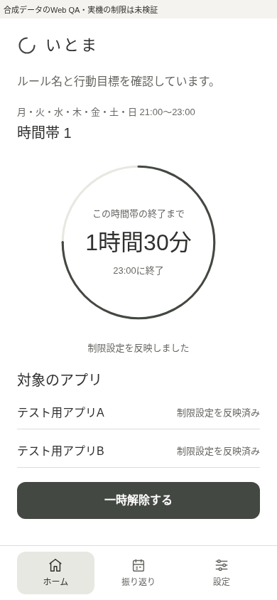
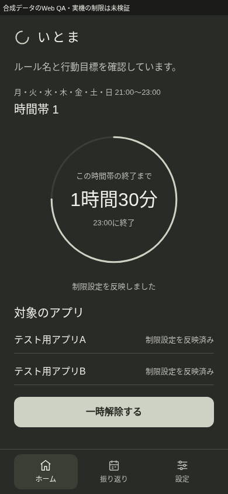
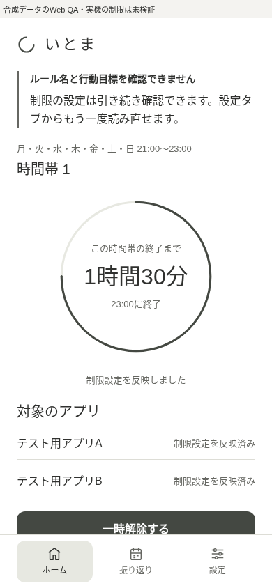

# private名前・目標の確認中表示（#218）

本人が報告した「画面を開く一瞬だけ取得不能の警告が出る」を修正する。確認中は穏やかな補足文、取得不能を確認した後は既存の警告・再読取操作を表示する。古い保存本文の非表示、revision下限、RAM編集中入力の保持は維持する。

## 対象と結果

検証source: `07207aecd204ab1fb38fa1abb651dce036044040`。この記録追加はアプリ入力を変更しない。`manifest.json`に変更sourceとQA fixtureのSHA-256、ブラウザ版、各画像のSHA-256を記録した。画像は合成データのLinux Chromium Web表示。製品のProvider・状態統合・Home/設定詳細/名前編集を使用し、native応答とアプリidentityだけを合成portへ置換した。

- PASS: TypeScript、Lint、Jest **250件/26 suites**、demoテスト4ファイル、`git diff --check`。
- PASS: 起動時の未確定AppState、背景復帰待ち、取得成功/不能、snapshotなしエラー、旧epoch/旧request失敗、progressだけのonboarding応答、revision下限、編集RAM入力をunit/componentで検証。
- PASS: Web Homeの正常→確認中→正常の間、DOM監視で取得不能の警告が一度も出ない。確認中は保存本文がなく、実際の取得不能では警告を表示し、次のreadで復旧する。
- PASS: Light/Dark390×844、320×844/DOM文字1.5倍で横overflowなし・スクロールして既存操作へ到達。設定詳細/編集の確認中、transport失敗表示、編集入力の保持。5ケースでページ例外なし。
- FAIL（既存依存）: expo-doctor **19/20**。SDK58の最新推奨に対し11件のpatch差。package.json/package-lock.jsonはmainと同一で、このPRでは更新しない。

## 画像

確認中はエラーのブロックを出さず、名前・目標を再確認している旨を表示する。

実際の取得不能では既存の案内を残す。

残りの画像は同ディレクトリ。画像はviewportで、内部ScrollViewの全内容を書き出したものではない。320pxの文字拡大はDOMによる補助確認で、円表示のレイアウトやiOS Dynamic Typeの合格判定には使わない。

## 再現用fixture

元sourceを一時ディレクトリへコピーし、`src/app`はproof用の2ファイルだけに置換する。`proof-layout.tsx.txt`を`src/app/_layout.tsx`、`proof-route.tsx.txt`を`src/app/proof.tsx`、`proof-provider.tsx.txt`を`src/qa/private-details-proof.tsx`、`proof-applications.tsx.txt`を`src/components/flow/applications.tsx`へ配置する。依存とsrc/modules/assets、Expo設定は同じsourceを使う。製品側へfixtureを配置しない。

一時コピーで`CI=1 EXPO_OFFLINE=1 npx --no-install expo start --web --port 8143`を起動。`capture.cjs.txt`を一時`.cjs`として保存し、PlaywrightとChromiumが利用可能な環境で、`ITOMA_DETAILS_SOURCE`（検証source）、`ITOMA_DETAILS_FIXTURE`（一時コピー）、`ITOMA_DETAILS_OUTPUT`（出力先）を指定して実行する。変更した製品source6ファイルはコピー側とのdigest一致も確認する。成功後に同sourceの画像/manifestを保存する。

## 検証の境界

Swift/bridge ABI/schema/依存/OS制御は変更しない。Simulator、新しい署名済みiPhone/iPad build、実際のFile Protection・lock/lifecycle・bridge遅延、VoiceOver/Dynamic Typeは今回未実施。以前のビルドや本人の基本動作確認を、この新JSの実機確認へ転用しない。

DESIGN §1/§3/§5、U05、UI08/UI21/UI23/UI25/UI37。SDK58のversioned indexはdocs.expo.devが環境の403で取得できず、Expo公式repoのsdk-58版 `docs/pages/versions/v58.0.0/index.mdx` を参照した。新しいExpo APIの採用や依存更新はない。
