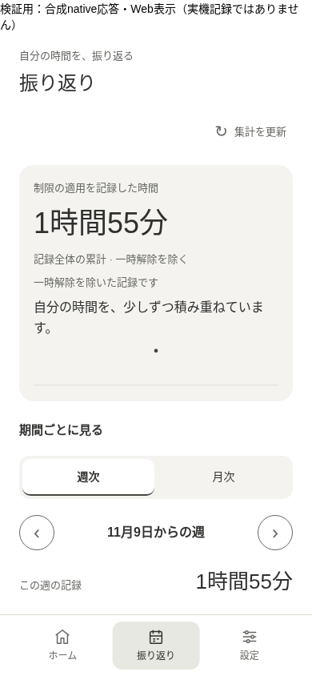
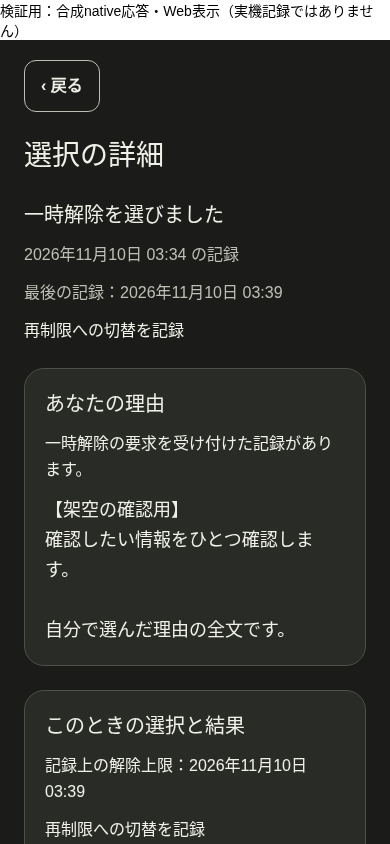

# 振り返り・選択の記録・詳細の本体接続（#206）

基準：[Issue206](https://github.com/kzk-maeda/itoma/issues/206)、固定デモ `da5d462a295366423cdfd43ea11b45ca8e2f2897`。base main `ceba9f29915f35fc133b436fe1c3b2fcaa584f0f` から必要なUIだけを移植した。通常のnative client、PR193の計測DTO/proofScope、PR209の要求単位集約/at/updatedAt、削除保護を使う。閉じたPR203の基盤・demo provider・比較切替は持ち込まない。

## 検証結果

- PASS：tsc、Lint、Jest **26 suites / 237件**、demo tools **32件**、iOS tools **18件**、expo-doctor **20/20**、diff check。
- PASS：通常構成のiOS JS/Hermes export、通常のserver Web export。これらはnative build/実機の成功ではない。Swift/native/configは変更していない。
- PASS：通常exportへ一時的なQA runtimeが混ざらないことを、製品sourceの復元と一意のmarkerの不在で確認。`prototype`の既定値やsyntheticFixture拒否を変更していない。
- PASS：Linux Chromiumで320/375/390/768px × Light/Dark、375pxはSE相当667高、320pxは文字200%、Reduce Motion。カレンダーの日付セルは全ケース44pt相当以上、横overflow/JS例外なし。Web文字拡大はiOS Dynamic Typeではない。
- PASS：固定累計→週/月→月端clip→日別、補助更新の非遷移/clip保持/token解放、日別の理由indexから全期間/eventへのリセット、カレンダー/絞り込み解除、エラー後の集計再取得。
- PASS：92件を40+40+12の3ページで自動追加し、cursorを重複要求せず末尾へ。詳細で選んだ理由1件だけを取得し、戻った時のscrollTop **21438→21438**、カード上端 **363→363**。先頭ページを読み直していない。詳細復帰後の自動追加、追加失敗/自動再試行停止/明示再試行も確認。
- PASS：Provider/component回帰テストで、追加中の日付/更新/削除/背景/client変更、revision/zone不一致、戻る方向/循環/空のcursor、不正な選択行、カード連打の重複選択、別sourceで同じcommand ID、遅い本文/ページの棄却を確認。

[機能操作結果](functional.json)、[幅・RAM結果](width-memory.json)、[入力・画像・iOS bundleのdigest](provenance.json)。36画像のdigestを保存し、代表7枚を本ディレクトリへ収録した。対象sourceのUI入力hashを照合済み。

## 画像

| 振り返り | タイムライン | 詳細 |
| --- | --- | --- |
|  |  |  |

[Dark](timeline-dark.png)、[カレンダー](calendar-light.png)、[320px/文字200%](calendar-320-large.png)、[日付絞り込み](day-filter.png)。すべて合成native応答によるWeb検証。実機の記録/OS制限結果ではない。

## 描画とRAM

390×844の合成Webで、初期40件/1ページから2000件/50ページまでスクロールした。同時描画は最大29カード。ChromiumのGC後JS heapは8.07 MB→11.13 MB、測定点の最大11.30 MB。これはブラウザー全体のJS heap（QA port・React・仮想リストの計測情報等を含む）で、iOSのRSS・FPS・最大容量の評価ではない。

成功したmetadataページは読み込んだ分だけRAMに残す。本文は1件だけ、全件の初回取得はしない。一定RAMを保証したり、途中で打ち切って本当の末尾と表示したりしない。保持ページ窓と実機予算は [#214](https://github.com/kzk-maeda/itoma/issues/214) で追跡する。

## 再現と隔離

[一時layout](proof-layout.tsx.txt) は同じ本体画面/Providerへ [合成port](proof-clients.ts.txt) を注入した。[機能操作](functional.cjs.txt) / [幅・RAM操作](width-memory.cjs.txt) はPlaywright＋Linux Chromium。QA Probeは件数だけを観測する。理由をURL/params/一覧metadataへ載せない。

一時runtimeを外し、元のRootLayoutへ戻してから型・Lint・全Jest・通常iOS/Web exportを検証した。配布・公開・実機保存の変更は行っていない。32枚の幅別画像と機能操作4枚の全digestはprovenanceに記録した。

## 受入条件との対応

| #206 | 実装/確認 |
| --- | --- |
| A01/A02 | 上部補助更新、固定累計、週/月、scope、下部全期間入口。期間/clip保持・失敗後再取得をcomponent/Webで確認 |
| A03/A04 | 同じhistory routeへの参照付き日別遷移、全期間/eventへの完全リセットをcomponent/Webで確認 |
| A05 | 取得zoneのGregorian日、カレンダー/今日/前後/解除。DST/年/月境界はpure helperと既存native契約、実操作はWeb |
| A06 | native行/cursorをそのまま使い、JSでcommandを再集約しない。atで日付を分類しupdatedAtは詳細の補足 |
| A07/A08 | 40件の継続、重複/停止/失敗/再試行、query/世代/削除/背景/zone変更の回帰テストとWeb操作 |
| A09 | 同じ世代で取得済みの行だけを選び、本文1件。閉じると本文を棄却しページと位置を保持 |
| A10/A11 | 保存のみ/取消/失敗/不明/再制限保留/削除/欠落を区別。未保存の当時情報は省略し現在設定で補わない |
| A12 | 既存の削除API/epochを維持。遅い本文/ページ/集計の非復活を回帰検証。物理端末の取込/削除競合は#135 |
| A13 | Web明暗/狭幅/文字200%/Reduce Motionとカレンダー44pt相当。VoiceOver/最大Dynamic Type/gestureは未検証 |
| A14 | Web2000件/50ページ、最大29描画、heap推移を記録。実機と保持ページ窓は#214 |

DESIGN原則1/3/4/5、U07、UI22〜26/35/36、RF01/05〜09。日時→選択→保存済み状態→理由/補足の階層、Graphite/HomeLayout/既存の期間モーションを再利用する。`reconciled`は早期終了にも使うため「再制限への切替を記録」とし、grantのfailed/uncertain/reblockPendingを元commandの成功や期限で隠さない。

## 実機への引き継ぎ

既存の #131 / #135 と連携する。PR193/209のnative変更を含むbuildと本PRのJSを使い、SHA/ビルドID/構成/端末/zoneを記録する。iOS JS exportを実機成功へ転用しない。

1. 振り返りで週/月/前後/月端clipを動かし、期間選択だけでは上部累計が変わらないこと。集計更新では現在の期間を維持して、新しい同じ時点の上下へ揃うこと。
2. グラフの日別→保存した理由→振り返り→最下部の全期間入口で、event/全期間へ戻ること。空の日でも絞り込みを解除できること。
3. 40件以上の履歴では過去への自動/手動読込、末尾、失敗後の再試行を確認する。過去ページのカード→詳細→戻るで、同じ位置/範囲へ戻ること。
4. 保存済みの理由・取消・削除済み等を開き、全文/選択/戻ると状態の区別を確認する。現在設定のアプリ名や目的が過去へ補われないこと。
5. 理由のみ削除/操作履歴削除では累計を維持し、全記録と累計の削除では双方を消すこと。背景/再取込/古い応答で復活しないこと。
6. SEの狭幅、Light/Dark、最大Dynamic Type、VoiceOver、Reduce Motion、戻るgestureとSafe Areaを確認する。スクロール/RAMは#214で実機測定する。

## レビュー対応

自動レビューのP1（元commandのsucceededがpending/scheduling/applying/activeのgrantを隠す）へ対応し、全grantStatusを明示的に表示する。未確認/失敗/再制限待ちを期限表示で隠さない優先順位も保ち、成功commandとの組み合わせ4ケースを追加した。

カード連打も追試し、旧実装では同じ行から理由readが2回発生することを確認した。選択中の同期ガードを追加し、2回の選択から1回だけ詳細を開き理由を読む回帰テストが通ることを確認した。戻る/背景/日付・source・削除/更新で選択ガードを解放する。
