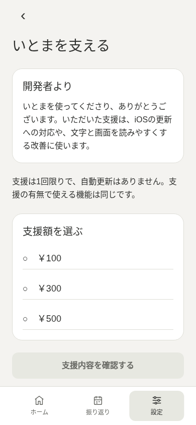
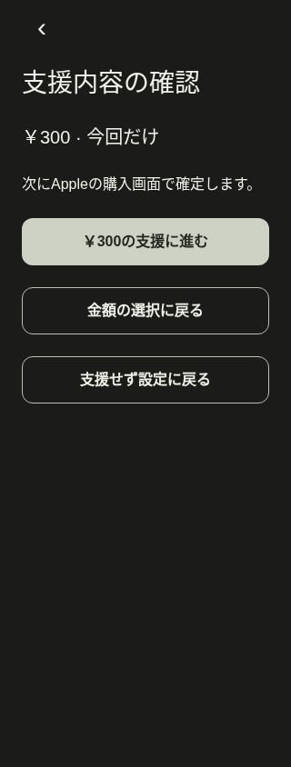

# iPhoneで単発支援を確認する

「設定 → いとまを支える」から、支援額を選択し「支援内容を確認する」へ。金額と「今回だけ」を確認して進むとAppleの購入シートが開く。設定へ戻った後の取引もアプリ本体が受け取る。

## App Store Connectの登録前に試す

1. 開発用ビルドで次の環境変数をCNGの生成時に指定する。既存のScreen Time用の設定も引き継ぐ。商品IDはInfo.plistに入るため、JSの再読込だけでは切り替わらない。
   ```sh
   export ITOMA_SUPPORT_PRODUCT_IDS=itoma.test.tip.1,itoma.test.tip.2,itoma.test.tip.3
   npx expo prebuild --platform ios
   ```
2. 生成したworkspaceをXcodeで開き、[Support.storekit](Support.storekit)をプロジェクトに参照追加する。アプリのターゲットへのコピーは不要。Edit Scheme → Run → Options → StoreKit Configuration で選択し、日本ストアの設定でアプリを実行する。3商品と価格はXcode専用の例。設定を外せばローカル商品の表示は終わる。
3. 未選択で進めないこと、価格の読み上げ、確定前の見送り、Appleシートの取消と購入、設定への帰還を確認する。XcodeのTransaction ManagerでAsk to Buyを承認し、支援画面を離れている間、アプリの再起動後の受信も確認する。SE幅、最大Dynamic Type、VoiceOver、ライト・ダークを確認し、ビルド・iOS・SHAを記録する。
4. 署名不要のSimulator取引テストはXcodeとXcodeGenのあるMacで `bash tests/ios/support/run.sh`。本体と同じSwift購入処理をテストホストに組み込み、StoreKit Test商品で価格変更、消耗型の購入、重複防止、永続化、保留・遅延承認を確認する。

## Sandbox・リリースに必要なもの

- 運営者が正式なBundle IDのApp Store Connectアプリに日本向けの**消耗型**商品を登録し、商品ID・価格・日本語表示・審査情報を確定する。有料契約、税務・銀行口座、対象国での販売可否を確認する。実際に発行した商品IDをカンマ区切りで `ITOMA_SUPPORT_PRODUCT_IDS` に渡してネイティブを再ビルドする。表示価格は毎回StoreKitの商品から取得する。
- Sandbox検証ではローカルStoreKit Configurationを解除し、正しいTeam／Bundle IDの署名ビルドと日本ストアのSandboxアカウントで商品・価格・購入結果を確認する。Apple側の設定反映や審査には時間がかかる場合がある。商品ID未設定、商品が見つからない、日本以外のストアでは支援額を選べない。
- Appleが支払いを処理する。照合用に購入ごとにランダムなUUIDを生成し、StoreKitへ渡す。本体はその結果待ちの印と、検証済み取引の環境・ID、お礼の未表示状態をバックアップ除外のApplication Supportに保存する。受理済みIDは再配送の重複防止のためアプリ削除まで保持し、結果待ちの印は処理完了または利用者による表示終了で解除する。理由・対象アプリとの対応表、サーバー・解析SDKへの転送は作らない。Apple側の購入履歴はアプリ削除後もAppleが管理する。
- 結果不明時の「購入結果を確認し直す」は未完了取引の照会だけを行う。Appleから承認結果が届かないまま24時間経過した場合は、状態画面で説明を確認して結果待ち表示を閉じられる。Appleへの依頼は取り消されず、後の承認も同じ取引処理を通る。
- 支援版配信前に購入履歴・支払い情報・問い合わせ・保持／削除の実態、署名配布版のSDK・通信を [#182](https://github.com/kzk-maeda/itoma/issues/182)・[#183](https://github.com/kzk-maeda/itoma/issues/183) と照合する。正式ポリシーの匿名閲覧とアプリ内リンクを確認する。[実装と実機受入 #282](https://github.com/kzk-maeda/itoma/issues/282)

## 本体画面のブラウザ確認

設定から実際のルートを開き、未選択、確認、金額の選択へ戻る、保留と設定への退出を確認した。画像はWebの購入ブリッジに合成商品を渡した本体UI。AppleシートそのものはXcode・Sandboxの検証対象。

| 未選択・390px | 確認・320px |
| --- | --- |
|  |  |
