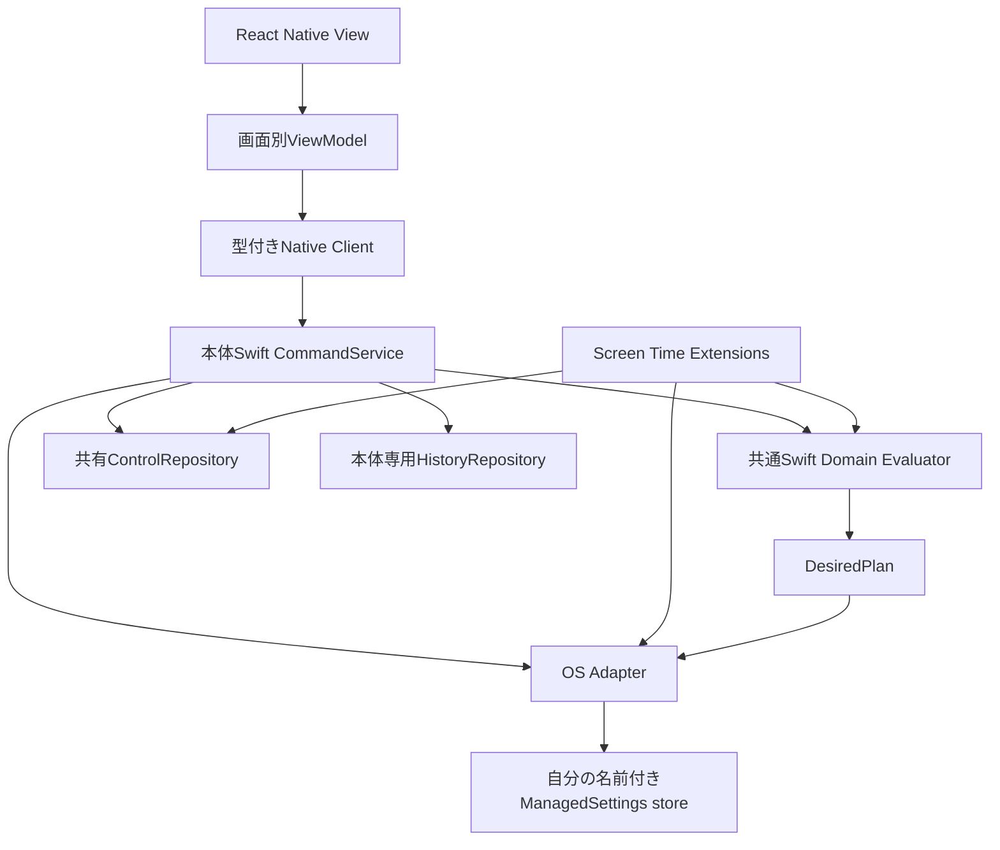
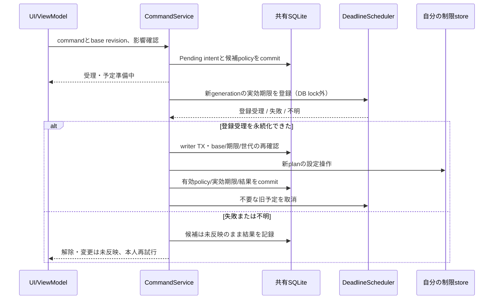

# 責務・更新プロトコル・画面の寿命

状態: **採用済み・実装/実機未検証**（[PR #36](https://github.com/kzk-maeda/itoma/pull/36)、2026-11-06 JSTにmainへマージ）。Issue [#24](https://github.com/kzk-maeda/itoma/issues/24)、[ADR 0005](../adr/0005-native-domain-and-mvvm.md)。根拠: [利用者回答](https://github.com/kzk-maeda/itoma/issues/24#issuecomment-6654590223)、[7項目の了承](https://github.com/kzk-maeda/itoma/pull/36#issuecomment-6685704584)。実装・実機検証は未実施。

## 比較と推奨

| 案 | 学習・単純さ | テストとOS独立動作 | 判断 |
| --- | --- | --- | --- |
| MVC相当（画面が状態・native呼出しを兼務） | 初期は少ない層 | 画面寿命と制限処理が結合しやすい | 小さいモックには十分だが中核には不採用提案 |
| **View＋ViewModel＋薄いService/Repository** | 画面、状態、Swiftの役割を追いやすい | I/O境界だけ差替え、純粋Swift評価を本体/Extensionで共有 | 推奨。MVVMはUI側の整理で、ドメインの正本はSwift |
| Redux等によるUI状態管理 | イベントの追跡はしやすいが学習・依存増 | MVVMと併用可能。Swiftをドメインの正本としたまま使える | 初版は追加依存・同期処理を増やさずhook/reducerから始める |
| 完全なClean Architecture・全操作のUseCase層 | 境界は厳密だが型・変換が多い | 強い分離を得られる | 必要なI/O境界は採用し、定型の層は増やさない |

UIのMVC/MVVMと状態管理ライブラリ、プロセス間の正本設計は別の問題。Redux自体が二重正本を必然的に生むわけではない。SwiftUIへの全面変更や、UIライブラリの追加は提案しない。

## 構成案

- 共通Swift層はFoundation等の時刻・値を入力として評価する。Expo・UI・DB・OS操作を直接呼ばない。
- 本体とExtensionへ同じSwiftソース/モジュールをリンクする。ExtensionはExpo/React Nativeランタイムへ依存しない。リンク方法は #9/#14 のビルドPoCで確認する。
- TSは表示用snapshotとcommand DTO、ViewModelの編集・表示状態を持つ。OS制限の優先評価をTSへ複製しない。Webデモは明示的なmock adapterと共通の仕様例で検証し、OS検証に数えない。
- OS Adapterは本体認可/Picker等の非同期処理と、制限planの反映を分離する。Swiftメソッド名や実APIの成功通知を本PRで捏造しない。
- 自分の安定した名前付きstoreへ、全ruleから算出した制限対象集合を反映する案。ruleごとのstoreの相互作用に解除判断を任せない。第三者の制限元を消す操作は行わない。

## コマンド契約（概念）

`submitCommand(commandID, expectedPolicyRevision, kind, payload)` は受理/拒否と追跡IDを返す。受理とOS反映完了は別。kindはcommitPolicy、requestTemporaryGrant、retryCommand、resumeAfterAuthorization、stop等に分ける。

同ID/同payloadは同じ受理結果、異payloadは拒否。payload照合にはimmutableなreasonRefを使い、本文や本文由来の単純hashをshared DBに出さない。結果はgetSnapshot/getCommandResultで再取得可能。イベント通知は更新のヒントであり配信保証のある正本ではない。画面復帰時・通知欠落後にはsnapshotを読む。

本人の再試行は同commandに新しいattempt番号を付け、grantID/initialExpiresAtは維持し、effectiveExpiresAtは延長しない。重複した同attemptの呼出しは再適用しない。途中でpolicy変更・期限切れならsuperseded/expiredとし、古い操作を強制再生しない。

## 予定登録・設定有効化・OS適用の契約（P1/P2対応）

SQLite、OSの予定登録、OS制限操作は単一トランザクションにできない。**解除前に、その実効期限で再評価を発火するOS予定の登録成功を確認する**。DBに期限を書いただけ、JS timerを作っただけでは解除しない。

責務はCommandService/Extension Reconcilerが処理順序を管理、DeadlineScheduler Adapterが予定登録/取消、ControlRepositoryがintent/登録receipt/世代を保存、Restriction Adapterが自分のstoreのplanを反映する。イベント名はgrantID・commandID・generationへ対応付け、理由本文を含めない。

以下の登録前提は新規解除と既存grantの期限更新に適用する。予定が不要な停止・即時再制限や、未認可で解除を伴わない設定保存を、解除用予定の登録失敗だけで妨げない。

### 処理の順序

1. 本人確認時のpolicyRevision・snapshotSequence・実効期限・影響するgrantを記録し、短いTXでPending intentをcommit。設定編集は**候補policy**を保存し、有効なPolicySnapshotをまだ上書きしない。失敗した候補も保持して本人が再試行/取消できる。
2. 最新状態から準備する期限予定を算出。新規解除だけでなく、既存grantの未来の優先切替が早まる編集も対象とする。API呼出し前にregistrationID/generation/scheduledForをPreparingとして短いTXで保存し、登録直後のkillでも残る予定を追跡できるようにする。
3. **DB lockの外**で新しいgenerationの予定を登録。OS APIが正常に受理したことをreceiptに記録し、短いTXでintentに関連付ける。影響する全grantの予定準備を必須とし、一部成功だけでは候補を有効化しない。API失敗・結果不明・receipt保存失敗なら新規解除も候補policyの有効化もしない。既存の有効policy/期限/保護予定を保持する。
4. writer TXを取り、現在の有効policyRevisionがbaseと一致すること、本人が確認した影響・期限が変わらないこと、認可/Activation、登録generation、未失効を再確認。変わっていれば有効化せず再確認または再準備。準備済みの古いplanを適用しない。
5. 登録済み保護予定を前提に、候補policy・grantの実効期限を有効化し、評価したOS planを短い同期区間で反映。結果と観測の限界を記録してcommit。OS操作とDB commitの隙間は残るため、Uncertainを区別する。
6. 旧予定の取消は、新状態がcommitされ必要な保護予定が登録済みになった後。既存grantの終了/停止時は再評価した制限状態の反映を確認してから不要予定を取消す。取消失敗は余分なcallbackとして扱えるようにし、解除成功と混同しない。

確認時のsnapshotSequenceと現在値が違う場合は影響を再計算する。終了時刻・対象・残る制限が確認内容と異なるなら再確認を要求する。未有効化候補を本人が取消した場合も最終TXで拒否し、有効状態を変えず候補予定を整理する。

### revisionと非同期処理

expectedPolicyRevisionはUIの編集開始版。受理しても有効policyRevisionを進めず、候補はcommandIDで隔離する。設定編集のcandidatePolicyRevisionはbase+1の候補であり、最終TXでbaseをCASしてから有効にする。別commandが先に同じbaseからcommitすれば残りはconflict。grant要求はpolicy版を変えずsnapshotSequenceを進める。

最終TX内でOS操作が失敗しても、登録準備が成立している候補は希望設定として保持し、反映失敗/不明を表示できる。ただし登録準備失敗の候補は有効化しない。この区別により、短縮した新期限を表示・有効化したのに、それを守る予定がない状態を作らない。

actorは本体内の順序付けのみ。プロセス間は短い共有SQLite writer TXで調停し、予定登録・認可要求・Picker・ネットワーク・UI待機のawaitをlock内へ入れない。OS制限設定自体が短い同期区間に収まるかは #26 で確認し、成立しなければ方式を再検討する。

Extensionも同じ排他・評価・結果記録を使う。lock timeoutは制限を緩和せずbusy/unknownとして扱う。期限や時間帯の新イベントによる評価と、失敗commandの再試行は別であり、失敗commandを無制限に自動再送しない。

### 登録receiptの意味とイベント処理

DeadlineRegistrationはregistrationID、grantID、commandID、generation、候補/有効policy版、scheduledFor、firedAt、状態（Preparing/Registered/Fired/Unknown/Failed/Obsolete）を保持。callback受信をfiredAtに記録し、最終TXの未発火/未失効照合に使う。RegisteredはAPI受理の証拠であり、将来の配信時刻・端末状態を保証しない。APIが期限を表現できない/登録を拒否する/結果不明なら、JS timerや別時刻への丸めで代替せず解除を拒否する。

- callbackはpayloadだけで旧grantを操作せず、**現在の有効policyとgrant**を再取得して評価する。候補policyは読めても有効設定として評価しない。
- 未有効化候補・旧世代・重複callbackは新grantを作らず、旧grantを復活させない。必要な現在状態の再評価は可能だが、古い期限を根拠に現grantを短縮/解除しない。
- 有効化前に予定が発火済み、または実効期限を過ぎた場合は解除しない。最新の有効policyに基づく再制限は別に行い、未有効化候補を勝手に適用しない。
- OS副作用後にDB rollbackしても、登録済みcallbackが最新の有効状態から再評価する経路を残す。予定そのものが呼ばれない障害までは保証できず、復帰時の確認と #26 の実測が必要。
- 停止・権限取消・rule更新時は先にgrantを無効化/再評価。取消失敗の古いcallbackでも、停止済みのruleを再適用しない。

### 失敗・中断の期待動作

| 条件 | 期待する扱い |
| --- | --- |
| intent保存失敗 | 旧有効状態を保持。新解除なし |
| 予定登録失敗/不明・receipt保存失敗 | 新解除なし。候補変更は未反映、旧grantの期限/予定は維持 |
| 登録成功後・有効化前にkill | 旧有効状態を維持。残った候補予定は最新有効状態を評価し、復帰時に整理 |
| 非同期登録中に別の設定/期限が変化 | 最終CAS/影響照合で拒否。勝手に新しい短縮を確定せず再確認 |
| 解除後・結果保存前にkill | Pending/Uncertain。保護予定は取消さず、callback/復帰で現在の有効状態を再評価 |
| 新しい短縮予定の登録失敗 | 編集を有効化せず旧期限を表示。旧予定を先に取消さない |
| 旧予定の取消失敗 | 新期限を延ばさない。古い世代のcallbackを冪等処理し、後で整理 |
| 過去版の「解除成功・予定登録失敗」を復旧時に検出 | 保護予定を確認できないgrantは解除根拠から外し、新解除を許さず、最新有効policyから即時の再制限を試みる。再制限失敗はUncertainとして残し、適用済みと表示しない |

通常プロトコルで「登録未確認のまま解除成功」へ進むことは禁止。この禁止と、OS登録APIの成功後に将来イベントが届かないリスクは別であり、後者の許容/代替はPoC結果で判断する。

## ViewModelとナビゲーション

Expo Routerを継続。ホームはsnapshot表示、編集はdraft専用ViewModel、解除はrequest専用ViewModel。React用ViewModelはhook＋plain reducer等から始め、クラス階層や新しい状態管理ライブラリを必須化しない。

- 編集開始時にbaseRevisionを保持。dirtyで戻る/画面を閉じる際は破棄確認を統一する。
- 反映の受理後は既存画面へ戻り、同じ画面をpushし直さない。エラーごとに画面を積まない。
- CommandServiceはViewModelの破棄に連動してcancelしない。本体プロセス終了後まで実行継続する保証は #26 の対象。
- 非表示/破棄時に購読・表示タイマーを解除。画面に巨大な履歴配列やnative tokenを保持しない。
- 履歴はページ取得、snapshotは小さいDTO。描画のたびにbridgeで全件取得しない。
- 同じ編集/反映/戻るを100回繰り返し、画面instance・購読・タイマー・メモリが増え続けないことを実装後に測定する。今は未検証。

## 調査・PoCゲート

共有SQLiteのプロセスkill/ロック/保護状態、共通Swiftソースの本体/Extensionビルド、OS Adapterの設定とreadback範囲、イベント上限・遅延、認可取消、Expo Moduleの通知/画面復帰を確認する。OSの全体的な実効状態を読み取れるAPIが存在すると仮定しない。

## CommandServiceの実装単位

[#83](https://github.com/kzk-maeda/itoma/issues/83)の[ItomaControl](../../packages/itoma-control/README.md)は専用native actorで新規grantの処理順序を実装する。Core/共有Storageへ依存し、private理由productはリンクしない。本体でPrepared→共有intentを閉じてから呼ぶ。Preparing/receiptの別commit、登録awaitのlock外実行、同期Restriction前の再検証、有限Evaluation/Observationと結果commitをfake adapterで検証する。

control schema5は最新の試行plan/観測を保持し、移行前の証拠を捏造しない。同期OS操作とcommitの隙間はUncertainとして残す。新規解除の単体ゲートを候補編集[#84](https://github.com/kzk-maeda/itoma/issues/84)、callback/停止/不整合復旧[#85](https://github.com/kzk-maeda/itoma/issues/85)、実API/実機#49/#50/#52の完了へ拡張解釈しない。

OS前にApplying観測を独立commitし、最終writerで同じevaluationIDを照合する。結果rollbackで旧Appliedを復元せず、別processが更新したmarkerからOS操作を始めない。全grantのCore失効recordを引き継ぎ、timezone/認可が戻っても旧解除を復活させない。認可不明のCore空集合をstore削除へ使わず、確定Deniedでは本人のpaused意図を保ちつつenabledを確認待ちへ移す。
