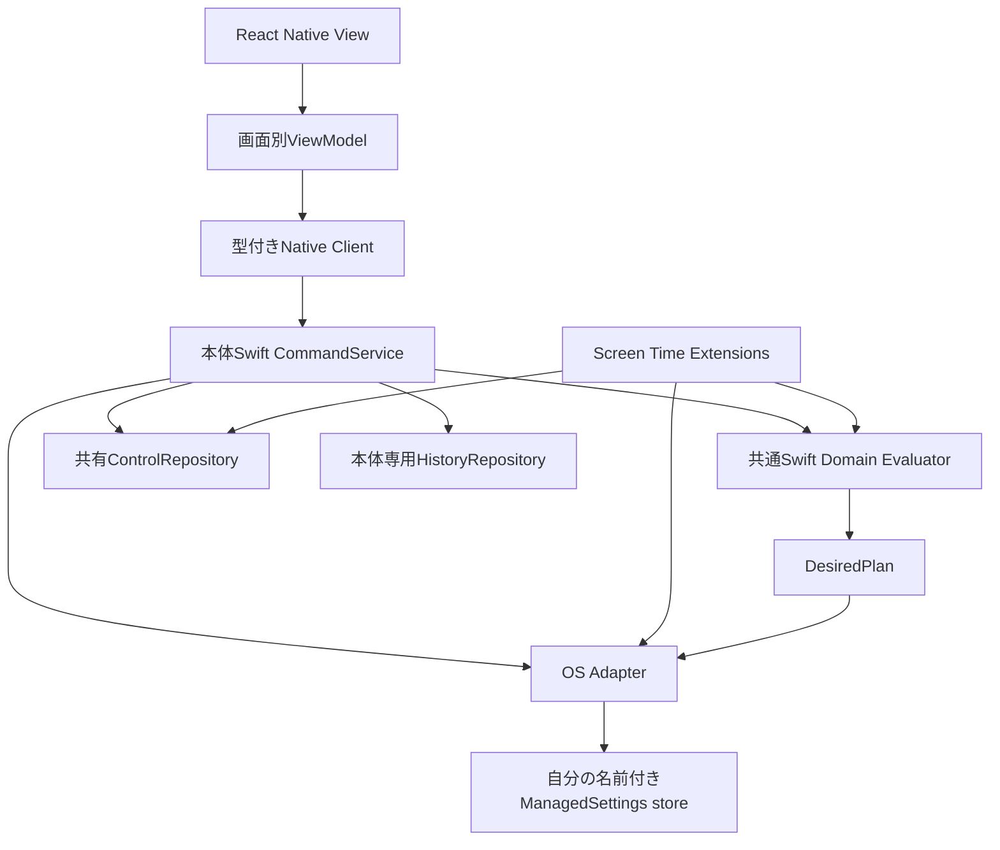
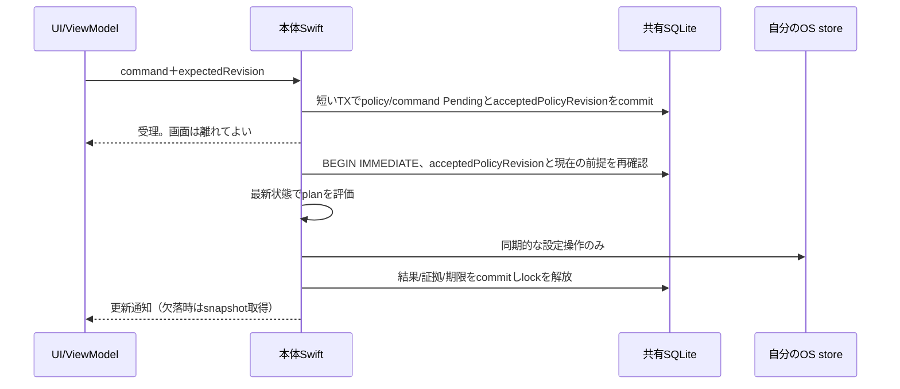

# 責務・更新プロトコル・画面の寿命

状態: **採用提案・レビュー待ち**。Issue [#24](https://github.com/kzk-maeda/itoma/issues/24)、[ADR 0005](../adr/0005-native-domain-and-mvvm.md)。根拠: [利用者回答](https://github.com/kzk-maeda/itoma/issues/24#issuecomment-6654590223)。実装・実機検証は未実施。

## 比較と推奨

| 案 | 学習・単純さ | テストとOS独立動作 | 判断 |
| --- | --- | --- | --- |
| MVC相当（画面が状態・native呼出しを兼務） | 初期は少ない層 | 画面寿命と制限処理が結合しやすい | 小さいモックには十分だが中核には不採用提案 |
| **View＋ViewModel＋薄いService/Repository** | 画面、状態、Swiftの役割を追いやすい | I/O境界だけ差替え、純粋Swift評価を本体/Extensionで共有 | 推奨。MVVMはUI側の整理で、ドメインの正本はSwift |
| Redux等の全状態を持つグローバルstore | イベントの追跡はしやすいが学習・依存増 | TS側とSwift側に2つの正本が生じやすい | 初版は採用しない |
| 完全なClean Architecture・全操作のUseCase層 | 境界は厳密だが型・変換が多い | 強い分離を得られる | 必要なI/O境界は採用し、定型の層は増やさない |

UIのMVC/MVVMとプロセス間の正本設計は別の問題。SwiftUIへの全面変更や、UIライブラリの追加は提案しない。

## 構成案

- 共通Swift層はFoundation等の時刻・値を入力として評価する。Expo・UI・DB・OS操作を直接呼ばない。
- 本体とExtensionへ同じSwiftソース/モジュールをリンクする。ExtensionはExpo/React Nativeランタイムへ依存しない。リンク方法は #9/#14 のビルドPoCで確認する。
- TSは表示用snapshotとcommand DTO、ViewModelの編集・表示状態を持つ。OS制限の優先評価をTSへ複製しない。Webデモは明示的なmock adapterと共通の仕様例で検証し、OS検証に数えない。
- OS Adapterは本体認可/Picker等の非同期処理と、制限planの反映を分離する。Swiftメソッド名や実APIの成功通知を本PRで捏造しない。
- 自分の安定した名前付きstoreへ、全ruleから算出した制限対象集合を反映する案。ruleごとのstoreの相互作用に解除判断を任せない。第三者の制限元を消す操作は行わない。

## コマンド契約（概念）

`submitCommand(commandID, expectedPolicyRevision, kind, payload)` は受理/拒否と追跡IDを返す。受理とOS反映完了は別。kindはcommitPolicy、requestTemporaryGrant、retryCommand、resumeAfterAuthorization、stop等に分ける。

同ID/同payloadは同じ受理結果、異payloadは拒否。payload照合にはimmutableなreasonRefを使い、本文や本文由来の単純hashをshared DBに出さない。結果はgetSnapshot/getCommandResultで再取得可能。イベント通知は更新のヒントであり配信保証のある正本ではない。画面復帰時・通知欠落後にはsnapshotを読む。

本人の再試行は同commandに新しいattempt番号を付け、grantID/expiresAtは維持する。重複した同attemptの呼出しは再適用しない。途中でpolicy変更・期限切れならsuperseded/expiredとし、古い操作を強制再生しない。

## 保存とOS適用の途中失敗

SQLiteとOS設定を同じ原子トランザクションにはできない。2段階のdurable intentを提案する。

expectedRevisionはUIが編集を開始した時点の比較値。受理TXで更新した後のacceptedPolicyRevisionとは異なる。OS操作前は後者と現行policyRevisionを照合する。設定変更commandならbaseRevisionより1つ進んだ版、grant要求なら受理時の設定版となる。

本体内actorは順序付けに使うが、**actor単体は別プロセスのExtensionを排他しない**。共有DBのwriter transactionを本体/Extension共通の調停点とする。DB lock中に認可要求、Picker、ネットワーク、UI待機、任意のasync処理を入れない。

OS設定操作を含むwriter区間は小さくするが、実APIで同期的・短時間に完了できる保証は #26 で確認する。lock timeoutは黙って制限緩和せずbusy/unknownとして記録・報告する。同期Adapterで成立しない、Extensionの時間予算に合わない場合は本方式を採用できず、新しい調停方式をADRで比較する。

| 失敗点 | 期待する扱い |
| --- | --- |
| intent commit前 | 確定設定は不変。本人へ保存失敗を返す |
| intent後・OS操作前 | Pendingが残る。中断時は未確定として本人の再試行へ |
| OS操作後・結果commit前 | Pendingが残り、成功とは断定しない。復帰時に取得可能な自分のstore値を再観測 |
| OS操作失敗 | Failedをcommit。確定policyは保持、本人が再試行 |
| 古いcommandの処理前にpolicy更新 | expected revisionを再確認しsuperseded。旧planを適用しない |
| ロック保持中にプロセスkill | SQLite回復後もintentを基に不明を検出。OS副作用はrollback済みと仮定しない |

Extensionも同じ排他・評価・結果記録を使う。期限や時間帯の新イベントは現在の確定状態を評価し、古いcallbackのpayloadをそのまま適用しない。失敗commandの無制限自動retryは行わず、次の正規イベントによる評価と本人の再試行を区別する。

## ViewModelとナビゲーション

Expo Routerを継続。ホームはsnapshot表示、編集はdraft専用ViewModel、解除はrequest専用ViewModel。React用ViewModelはhook＋plain reducer等から始め、クラス階層や新しい状態管理ライブラリを必須化しない。

- 編集開始時にbaseRevisionを保持。dirtyで戻る/画面を閉じる際は破棄確認を統一する。
- 反映の受理後は既存画面へ戻り、同じ画面をpushし直さない。エラーごとに画面を積まない。
- CommandServiceはViewModelの破棄に連動してcancelしない。本体プロセス終了後まで実行継続する保証は #26 の対象。
- 非表示/破棄時に購読・表示タイマーを解除。画面に巨大な履歴配列やnative tokenを保持しない。
- 履歴はページ取得、snapshotは小さいDTO。描画のたびにbridgeで全件取得しない。
- 同じ編集/反映/戻るを100回繰り返し、画面instance・購読・タイマー・メモリが増え続けないことを実装後に測定する。今は未検証。

## 調査・PoCゲート

共有SQLiteのプロセスkill/ロック/保護状態、共通Swiftソースの本体/Extensionビルド、OS Adapterの設定とreadback範囲、イベント上限・遅延、認可取消、Expo Moduleの通知/画面復帰を確認する。OSの全体的な実効状態を読み取れるAPIが存在すると仮定しない。
