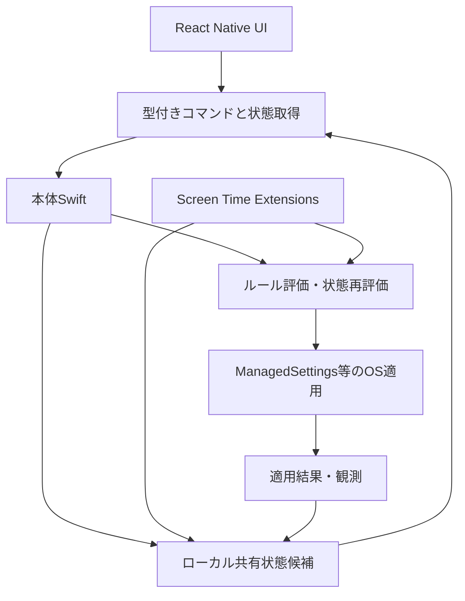
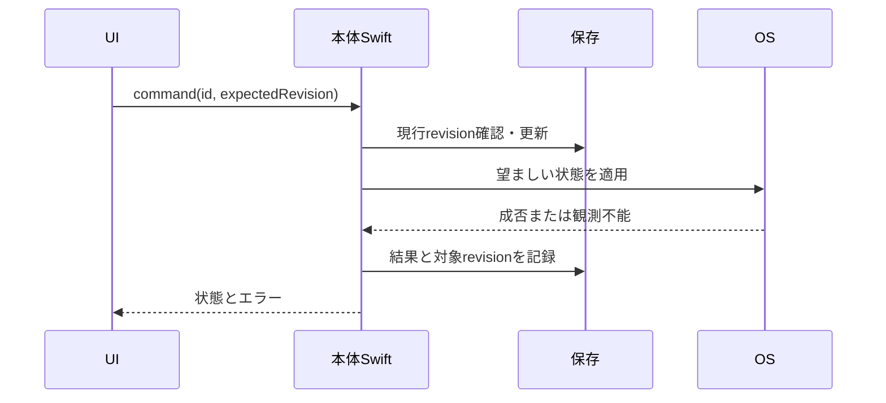

# 責務とデータフロー

状態: **提案・未確定**。検討Issue: https://github.com/kzk-maeda/itoma/issues/24。この文書は実装・OS動作の保証ではありません。

## コンポーネントの初期案

| 要素 | 責務案 | 持たせない保証 |
| --- | --- | --- |
| React Native | 入力、取消、状態説明、アクセシビリティ | バックグラウンド期限タイマーの実行保証 |
| 本体Swift | 認可・対象選択・コマンド受付・復帰時の再評価 | JS常駐の前提 |
| Extensions | OSイベントに応じた共有状態評価・制限操作 | 本体アプリ起動や任意UI表示の保証 |
| 共有保存 | 版付き状態の保持とプロセス間受け渡し | 保存成功とOS適用成功の同一視 |

## コマンド処理案

保存とOS操作は単一トランザクションにできると仮定しません。途中失敗、結果保存失敗、同時Extension操作からの回復方式が設計Issueの主要な問いです。

## 決める契約

コマンドのID・入力revision・結果型、正本のプロセス/保存先、排他と冪等性、UI通知の配信と再取得、Extensionの読み書き権限、復帰時の再評価、エラー分類。Swift側で独立動作するルールにTSと異なる解釈を持ち込まない方法も比較します。

Shieldから本体への導線やOSイベントはhandoverの候補で、APIの実現可能性は未検証です。実装前に公式資料と対象OSを確認し、実機PoCの結果をADRへ残します。
