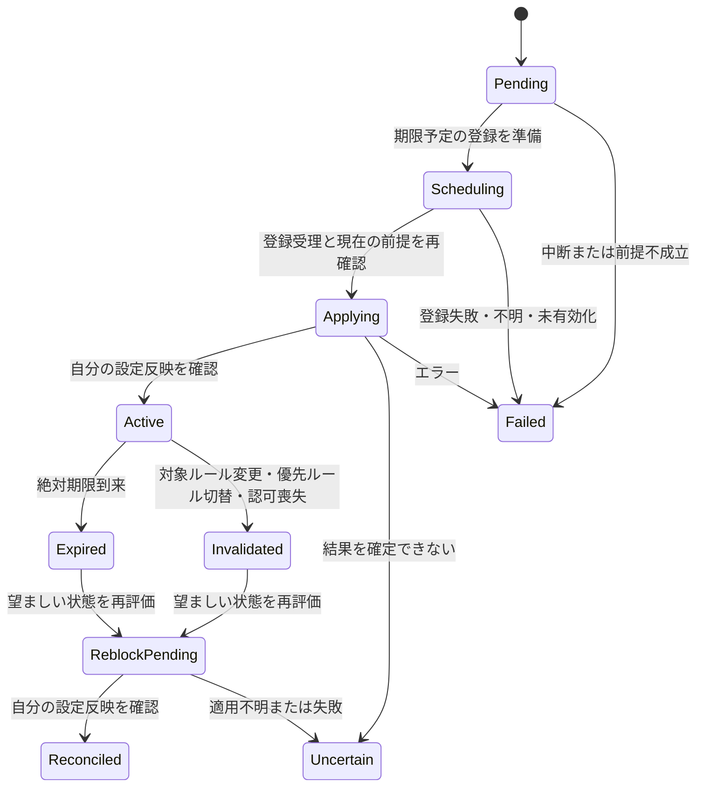

# ドメインモデルと状態遷移

状態: **設計採用済み・実装の検証範囲は下記、実機未検証**（[PR #36](https://github.com/kzk-maeda/itoma/pull/36)、2026-11-06 JSTにmainへマージ）。[了承コメント](https://github.com/kzk-maeda/itoma/pull/36#issuecomment-6685704584)。Issue [#22](https://github.com/kzk-maeda/itoma/issues/22)。判断理由は [ADR 0003](../adr/0003-domain-state.md)。ドメイン全体・OS動作の検証済み宣言ではない。

要望の根拠: [利用者回答](https://github.com/kzk-maeda/itoma/issues/22#issuecomment-6654445560)。ホームに現在の制限・次の開始・解除残時間を表示、編集中の破棄は確認、適用失敗でも設定を保持、解除期限は絶対日時、再認可後の再適用は本人に確認する。

## 用語と正本

| 概念 | 主な値・識別子 | 意味 |
| --- | --- | --- |
| AuthorizationObservation | unknown/denied/approved、observedAt | OSから取得した観測。revokedは過去approvedからの変化イベントとして記録。独自のOS enumを捏造しない |
| Activation | enabled / awaitingReauthorizationConfirmation / paused | 認可と別の本人の制御。再許可されただけでは自動で制限を再開しない |
| Rule | ruleID、ruleVersion、enabled、selectionRef、schedule、unlockMode | 対象と時間帯、理由/ダミー課金/一時解除不可。変更時にversionを増やす |
| PolicySnapshot | schemaVersion、policyRevision、rules、priorityOrder | 全ルールの有効な設定の正本。Pending候補とは分離し、準備完了後にcompare-and-swap |
| Selection | selectionRef、opaque native tokens | Swiftで保持する対象選択。文字列のアプリ名をOS対象と扱わない。Swiftで復号したtokenの同一性でtargetRefを正規化し、encodeされたバイト列だけを同一性の根拠にしない |
| EditDraft | baseRevision、差分、dirty | 画面内の未確定編集。OS適用・確定設定とは分離 |
| Command | commandID、payloadDigest、expectedPolicyRevision、candidatePolicyRevision、kind、status | 本人が確定した操作。重複実行を検出し画面の寿命から独立 |
| TemporaryGrant | grantID、targetRef、ruleID/version、occurrenceKey、acceptedAt、initialExpiresAt、effectiveExpiresAt、status | 対象アプリ1つ・その時間帯の優先ルールに限る一時解除。要求と付与を区別 |
| DeadlineRegistration | registrationID、grantID、commandID、generation、scheduledFor、firedAt、status | OS予定の受理/発火記録。DB上の期限だけではRegisteredと扱わない |
| Evaluation | evaluationID、policyRevision、evaluatedAt、timezone、nextBoundary、desiredTargets | その時点で望ましいOS設定。policyの保存成功とは別 |
| ApplicationObservation | evaluationID、status、evidence、observedAt、validUntil、error | 最後の自分のOS設定操作/観測。system-wideな実効制限を断定しない |
| HistoryEvent | eventID、commandID/grantID、type、occurredAt、result、reasonRef | 取得可能な自アプリ操作の履歴。理由本文は別の本体専用保存 |

ルール編集はPending候補を永続化し、予定登録等の準備後に有効化した時点でpolicyRevisionを進める。ruleVersionは該当ルールの対象・時間・モード・有効状態の変更時に進める。グローバルな解除時間設定の変更は既存grantの期限を書き換えない。評価IDは時間帯境界・grant変化も区別し、policyRevisionだけで適用鮮度を判定しない。shared snapshotには全変更で増加するsnapshotSequenceも付け、UIが古い非同期通知で新しい表示を巻き戻さない。

## 状態の組合せ

認可・確定設定・実行中command・grant・OS観測は独立軸。単一の `isBlocked` では表現しない。

この図はgrantの論理状態。OSイベントが期限どおりに到着することは #26 の検証対象。期限を過ぎたgrantは、再制限に失敗してもActiveへ戻さない。

## 本人操作の遷移表

| 事前状態・入力 | 保存/状態の期待 | UI・次の操作 |
| --- | --- | --- |
| Draftがdirty、戻る/取消 | 破棄確認。続けるならDraft維持、破棄なら確定policy不変 | 無言で破棄しない。理由入力の破棄も同じ原則 |
| Draftを反映、expectedPolicyRevision一致 | 候補policyとPending commandを永続化。有効policyは準備後に更新 | 「反映中」。画面を離れても本体Swiftが処理を所有 |
| expectedPolicyRevision不一致 | 上書き拒否。最新snapshot取得 | 編集差分を保持し、再確認。自動上書きしない |
| 同commandID・同payloadを再送 | 同じcommand結果。新grantを作らない | 連打・通信境界で二重付与しない |
| 同commandID・異payload | 不正な再利用として拒否 | 新しい操作IDで確認し直す |
| 反映中に画面終了 | commandを取消しない | 次の表示時にsnapshot/command結果を再取得 |
| OS適用失敗・不明 | 登録準備済みのpolicyは保持、Failed/Uncertain、旧観測と区別。予定登録失敗なら旧有効policyと未反映候補を別保持 | 「適用できていない/確認できない」、本人の再試行 |
| 再試行 | 同一commandの期限・意味を保持して前提再検証 | 期限切れ・rule変更なら再試行不可。新しい解除として再確認 |
| 権限取消を観測 | policy保持、grant無効、Activationを確認待ちへ | 未適用を表示。再認可だけで自動再開しない |
| 未認可のまま設定を編集 | policyは保存可能、未適用/認可必要として保持 | 認可要求と設定保存を混同しない |
| 本人が全体を停止 | Activation paused、全grant無効、残る自分の設定を再評価 | 停止失敗も表示。編集しただけで自動再開しない |
| 再認可後に再開を承認 | 現在のpolicyを新評価で適用 | 古いgrantを復活させない |
| 本体killでcommand中断 | 次の取得で未確定/中断を表示 | 無条件に成功・自動再試行と扱わない |

OS操作に副作用がなかったと判断できる入力検証エラー等はFailed、途中まで適用された可能性があるものはUncertainに分ける。Uncertainを新しい要求IDで迂回して期限を延ばさない。

通常の戻る/閉じるには破棄確認を行うが、OSによる強制終了・メモリ回収の直前に確認UIを必ず出すことはできない。アプリ切替だけではDraftを捨てず、初版の未確定Draftはメモリのみとする。OS終了後のDraft復元が必要なら、別の保存・プライバシー判断を行う。

## 絶対期限と表示

解除を受理した時点で `initialExpiresAt = min(acceptedAt + duration, 現occurrence終端, 次の優先ルール切替)` を保存する。effectiveExpiresAtはこの値で開始し、後の編集で同じgrantの期限を**短縮だけ**できる。再試行/遅延/切替削除で延長しない。

残時間は **`max(0, effectiveExpiresAt - now)`** から計算し、確認画面・OS登録のscheduledFor・有効なgrantのeffectiveExpiresAtを一致させる。initialExpiresAtから表示するとP2の早期終了問題を再発するため使用しない。候補変更の短縮値は準備中の提案として表示し、登録と有効化が完了してから現在残時間へ反映する。

[architecture.md](architecture.md) の登録受理確認を解除の必須前提にする。受理済み予定でもOS配信の保証ではなく、時計変更と配信遅延はPoCで検証する。

画面内タイマーは表示更新にだけ使う。OS操作が遅れても期限を後ろへずらさず、実際に解除できる時間が短くなる可能性を表示する。時計変更への限界は [rules.md](rules.md) に定義する。

ホームは「設定上の制限対象」「次の開始」「解除期限」を導出し、最後の反映時刻・未適用/不明を併記する。自分のManagedSettings設定値を読めても、他の制限元やOS全体の実効状態を証明したことにはならない。`ApplicationObservation.evidence` をwriteAttempt / ownStoreReadback等に分類し、APIにない成功通知を仮定しない。次境界を過ぎた観測や時計/認可変更後の観測を現在の確認済み状態として表示しない。

## 不変条件

1. 確定前の取消はpolicy・grantを変えない。確定後は「未反映編集の取消」で処理を巻き戻さない。
2. 認可済み・有効化承認済み・有効な優先ルールがなければ、新grantを付与しない。
3. grantは対象・ruleVersion・occurrenceに束縛。別ルールや次の日へ流用せず、無効化後に復活しない。
4. 保存成功、OS設定操作成功、対象アプリが本当に開けないことは異なる証拠。
5. 同じtargetRefにPending/Active/Uncertainな未終端grantは1つ。別commandIDで連打しても既存grantを返し、期限を延ばさない。
6. 失敗は本人が再試行。予定された時間帯開始/期限終了の新イベント処理は必要だが、失敗commandを無制限に自動再送しない。
7. 達成時間・生産性の可視化は将来機能。取得できない実利用時間を履歴から推測して事実表示しない。

## Swift値型と検証の境界

値型の実装は[ItomaCore](../../packages/itoma-core/README.md)を参照。#42では識別子・版・時刻、policyと候補、command/grant/予定登録/観測の型と、構造的な入力検証を扱う。現在時刻・timezoneは`EvaluationContext`へ明示的に渡す。native token・理由本文・生のOSエラーは共通モデルへ持ち込まない。

代表的な不正入力・policyの版付き復元はSwift単体テストで確認する。型の構築成功は操作許可やOS適用成功ではない。以下のDケース全体の状態遷移・同時操作・期限処理・OS復旧が実装/検証済みになったとは扱わない。

### 一時解除の純粋評価

[#44](https://github.com/kzk-maeda/itoma/issues/44)の[ItomaCore](../../packages/itoma-core/README.md#一時解除と編集影響を評価する)は、新規Pending候補、既存grantの有効性/残時間/失効、候補編集による短縮と確認内容の再照合を扱う。本人確認・予定登録・有効化・OS操作はcontrollerの責務に残す。現在のpolicyとは別に編集候補を評価し、計算だけでは旧policy/実効期限を変えない。

失効や時計不整合は新しい論理記録として返し、次の評価へ永続化して引き継ぐ。terminalなgrantを再評価でActiveへ戻さない。Pending/Uncertain/Failed等の未終端記録で新しい要求を受けても同じ記録を返し、新期限を作らない。ID/同対象の破損した重複を任意の1件へ修復しない。厳密なpayload照合とプロセス間の同時受理は#45/#47で別途実装する。

R/D表の該当部分は合成したSwift入力で検証する。新しい期限のOS予定登録、取消/登録失敗の実I/O、DB競合、iOS/実機の成功を証明するものではない。

## 実装へ渡す状態遷移テストケース

| ID | 入力・障害 | 期待 |
| --- | --- | --- |
| D01 | 編集後に戻る→破棄を拒否→破棄を承認 | Draft維持後に破棄、確定値不変 |
| D02 | 別画面の更新後に古いbaseRevisionで反映 | conflict。最新値を上書きしない |
| D03 | commandを2回送信 | 1grant、1受理イベント、同じ実効期限 |
| D04 | 解除開始後2分で再表示（設定5分） | 同じ終了日時、残り約3分。新たに5分を開始しない |
| D05 | 受理後にOS反映が期限まで遅延 | 新たな解除を行わず期限切れ扱い |
| D06 | OS設定変更後・結果保存前にkill | Pendingから不明を復元。適用済みと断定しない |
| D07 | 期限イベント重複・古いruleVersionのイベント | 最新状態で冪等評価、旧grantを復活させない |
| D08 | 認可取消→再許可 | rule保持、grant無効、再開承認前は再適用しない |
| D09 | policy保存成功/OS失敗 | 設定保持、失敗と本人再試行を表示 |
| D10 | 次境界を過ぎても観測更新なし | 希望状態は算出し、適用観測は不明として表示 |
| D11 | 異なるcommandIDで同対象の解除を同時要求 | 1grant。受理TX内で重複を検出し、既存期限を保持 |
| D12 | grantがUncertainの間に別IDで解除要求 | 新たな期限を付与しない。現grantの結果確認・同grantの明示再試行または期限後の新規確認へ |
| D13 | 期限予定登録を拒否/不明にする | 新規解除なし。有効policyと旧保護予定を維持 |
| D14 | 登録成功→有効化前、または解除後→結果commit前にkill | 候補/不明を区別。登録経路を残し、callbackで最新有効状態を評価 |
