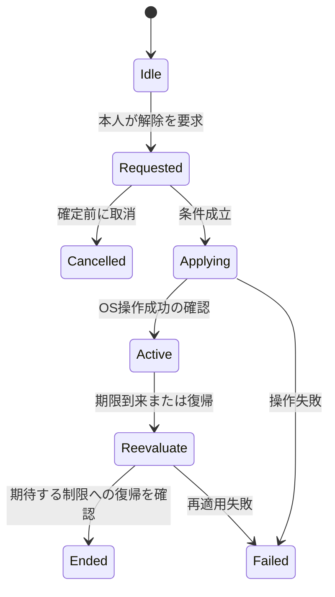

# ドメインモデルと状態遷移

状態: **提案・未確定**。検討Issue: https://github.com/kzk-maeda/itoma/issues/22。この文書は実装・OS動作の保証ではありません。

## 初期モデル

単一の「制限中」フラグに集約せず、独立する状態を組み合わせる案です。型・保存形式・OSから取得できる情報は未確定です。

| 概念 | 持たせる情報の候補 | 分離する理由 |
| --- | --- | --- |
| Authorization | unknown / denied / approved / revoked相当、確認時刻 | 過去の許可は現在の許可を保証しない |
| Selection | 不透明な対象選択、revision | 名前文字列とOSトークンを混同しない |
| RestrictionPolicy | 対象参照、時間帯、解除条件、revision | 利用者が望む設定を表す |
| TemporaryAccess | 要求ID、適用先policy revision、状態、期限 | 解除要求と解除成功を区別する |
| ApplicationResult | requested/applied/failed/unknown相当、対象revision、観測時刻 | 設定保存だけでOS適用済みにしない |
| LocalEvent | 操作ID、種別、結果、発生時刻 | 取得可能な自分の操作だけを履歴化する |

これは一時解除の概念図です。条件、権限取消、policy変更、古いイベント処理を含む完全な遷移表は検討Issueで決定します。図に存在する矢印がOSで実行可能であることは未検証です。

## 不変条件の提案

- キャンセルは確定済みpolicyを変えない。要求取消と適用済み解除の終了は別操作とする。
- 設定revisionと観測revisionが一致しない場合、最新設定が適用済みと表示しない。
- 同じ操作IDの再試行で解除期間や履歴を二重付与しない。
- 期限切れは論理状態。再制限のOS適用成功とは別に記録する。
- 権限の未確認・取消・観測不能を「ブロック中」に丸めない。

## 遷移表の検討ケース

未認可で適用、編集中の取消、同時操作、policy変更中の解除、期限境界の再起動、保存成功/適用失敗、OS適用成功/結果保存失敗、古いExtensionイベント、権限取消、観測が古い場合。各ケースの入力・事前状態・期待結果・復旧を記載してから実装へ渡します。
