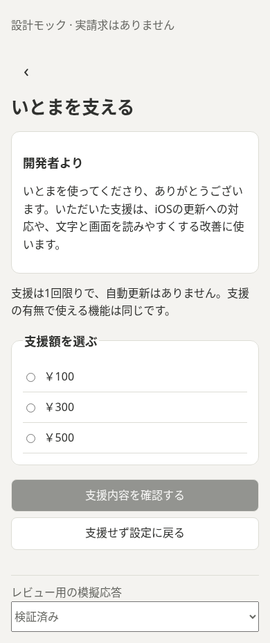
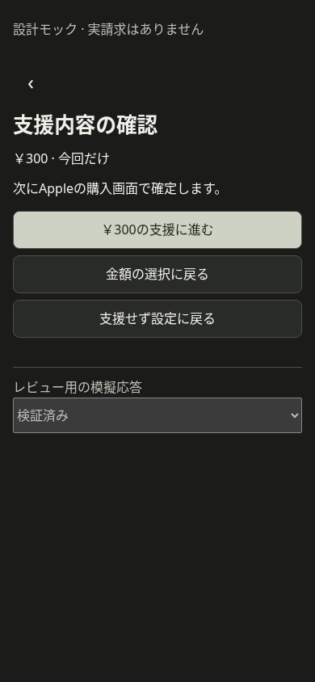
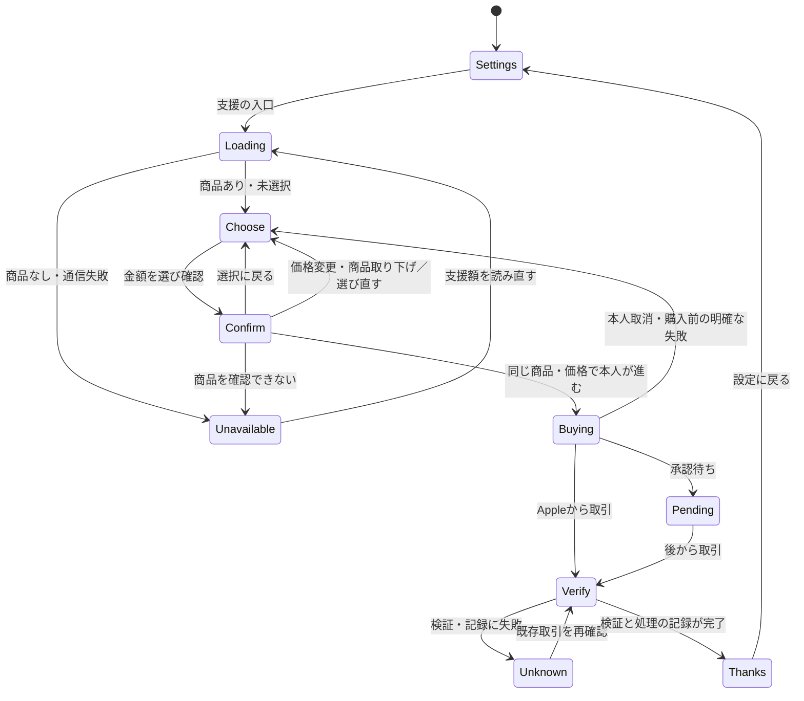

# 設定から、いとまを支える

日本のiPhone版で、開発と運営に一度だけチップを送る人のための設計案。支援を見送っても、同じ制限・一時解除・振り返りを使える。[設計 #280](https://github.com/kzk-maeda/itoma/issues/280) ／ [StoreKit実装・実機受入 #282](https://github.com/kzk-maeda/itoma/issues/282)

## 画面を試す

[操作モック](mock.html)をダウンロードし、ブラウザで開く。設定の末尾から支援画面に入り、金額を選んで確認へ進む。外側の「レビュー用の模擬応答」で条件を選ぶ。商品読込エラーは入場または再読込時、価格変更・商品取り下げは確定時に反映する。「模擬の取引結果を受け取る」はAppleからの非同期通知の代役。保留の後に「検証済み」を選ぶと承認後も試せる。再読み込みで模擬状態をリセットする。例示の金額・通知はメモリ内に限る。[先行デモ #279](https://github.com/kzk-maeda/itoma/pull/279)

| 金額の選択 | 確認（ダーク） |
| --- | --- |
|  |  |

## 画面と読み順

| 場所 | 表示と操作 |
| --- | --- |
| 設定 | 「使い方とこのアプリ」の次に既存の設定行と同じ「いとまを支える」／「開発と運営への任意の支援」を置く。支援の入口はこの一行。バッジや支援履歴は表示しない。 |
| 支援 | 戻る、見出し「いとまを支える」、開発者の手紙、今回の条件、価格選択、確認、見送りの順。手紙は「いとまを使ってくださり、ありがとうございます。いただいた支援は、iOSの更新への対応や、文字と画面を読みやすくする改善に使います。」続いて「支援は1回限りで、自動更新はありません。支援の有無で使える機能は同じです。」 |
| 金額 | 読込成功で、対象ストアで取得できた消耗型商品のみを同じ強さで価格の昇順に並べる。初期値は未選択。StoreKitの `Product.displayPrice` をそのまま使い、選択後だけ「支援内容を確認する」を有効にする。 |
| 確認 | 選んだ価格と「今回だけ」を示す。「〈表示価格〉の支援に進む」で商品と価格を再検証してAppleの購入シートを開く。「金額の選択に戻る」は選択を保持。「支援せず設定に戻る」は選択を破棄。左上の戻ると戻るジェスチャーも同じ階層へ。 |
| 結果 | 下の状態図に従う。決済中・保留中も設定に戻って普段の操作を続けられる。結果が別画面で届いても表示中のタブを切り替えない。検証済みの取引についてだけ、支援画面で「ご支援ありがとうございます」「いとまの開発と運営に役立てます。」と「設定に戻る」を表示する。 |

[原則1・4](../../../DESIGN.md) に沿い、金額の選びやすさと退出のしやすさを両立する。「墨と白」の背景・面・本文・補足・操作の意味色をLight／Darkで共有し、選択をチェックと読み上げでも伝える。全操作のタップ領域は44×44pt以上。SE幅・最大文字では縦に折り返してスクロールし、価格・確定・見送りの語尾まで読めるようにする。ページ遷移は見出しへ、設定に戻ると入口へフォーカスを移す。VoiceOverで金額・選択状態・確認の可否・変更理由を読めること。非同期結果は変化したときに一度だけ伝える。[UI24・UI27・UI35](../../ui-acceptance.md)

## 購入状態

どの支援画面からも設定へ退出できる。読込中は「支援額を読み込んでいます」。空の場合は「現在、選べる支援額がありません」、通信失敗は「支援額を読み込めませんでした」とし、「支援額を読み直す」を出す。本人取消は「購入を取り消しました」、購入が始まらなかった場合は「購入手続きを進められませんでした」と表示し、選択を保持して本人の操作を待つ。結果不明を購入前エラーへ丸めない。

保留は「承認待ちです。Appleから結果が届くまでお待ちください」。画面離脱は購入の取消にならない。期限経過や再起動を成功・否認と推測しない。購入結果の検証失敗は「購入を確認できませんでした」とし、「購入結果を確認し直す」で処理中の取引だけを再照会する。

### 取引を一度だけ扱う境界

1. Swift本体の購入処理担当が、画面のライフサイクルから独立して起動時に `Transaction.updates` の監視を開始し、`Transaction.unfinished` も照合する。JSは表示・選択・購入の依頼を担う。Extensionは購入情報を参照しない。
2. 確認画面で同意した商品ID・ストア・通貨・数値価格・表示価格を確定前に再取得して照合する。差があれば選択を外して再確認。取得不能・商品なしは購入を呼ばない。連打・再入場が同時に来ても購入開始を一つに直列化し、照会と新規購入を別の操作にする。
3. `purchase()` の返り値、更新通知、起動時照合を同じ取引処理へ渡す。`.pending` と `.userCancelled` は取引完了にしない。Appleの検証結果が `.verified`、許可した消耗型商品・環境・アプリに一致し、取消済みでない取引を受理する。取引IDが取得できる前の保留は操作中の印だけを保持し、アプリの経過時間から結果を作らない。
4. 本体専用ストレージで環境と `Transaction.id` を一意キーに、処理済み印と表示待ちのお礼を原子的に記録してから `finish()` する。同じ取引が再配送されたら未完了のfinishだけを再試行する。書き込み失敗・未検証では完了にもfinishにも進めない。お礼の表示済み印を使い、再配送で再掲しない。本人の次の支援には別の取引IDが付くので同額でも処理できる。
5. Ask to Buy等で後から承認された場合も同じ検証を通す。保留時に別の購入を勧めない。保留の却下通知が得られないケースは Sandbox で確認する。保留フラグのみで以後の新規支援を永久に塞がないこと、結果待ちの自動再購入を起こさないことを実装受入に含める。

[StoreKitの購入結果](https://developer.apple.com/documentation/storekit/product/purchaseresult) ／ [非同期更新](https://developer.apple.com/documentation/storekit/transaction/updates) ／ [未完了取引](https://developer.apple.com/documentation/storekit/transaction/unfinished)

## 審査とデータの流れ

日本向け初版には3.1.1の開発者へのチップに沿って消耗型IAPを提案する。購入は1回で完結し、追加機能・解除条件・広告とは独立する。個人間贈与の例外を前提にせず、外部購入リンクや独自決済を設けない。日本の外部決済を選ぶ場合は別途制度・手続き・IAP併記等の確認が必要。月額案は3.1.2(a)の継続的価値から再検討する。[App Review Guidelines](https://developer.apple.com/app-store/review/guidelines/) ／ [日本の決済オプション](https://developer.apple.com/jp/support/payment-options-on-the-app-store-in-japan/)

| 情報 | 誰が何のために扱うか | 保存・送信・削除の境界案 |
| --- | --- | --- |
| 支払手段・Appleの購入認証 | Appleが購入シートで決済 | アプリに入力欄を設けず、運営者はカード番号や認証情報を取得しない。Apple側の保存・削除はAppleが管理。 |
| 商品ID・ストア・価格 | アプリがStoreKitから取得し、表示価格と同意内容を照合 | 表示中のメモリに保持。運営サーバー・分析SDKへの送信なし。 |
| 保留・購入結果・取引ID | StoreKitと本体が検証、未完了処理と二重処理防止に利用 | アプリのprivate領域に最小の処理状態を置く。理由・対象アプリ・ルール・選択の記録と結合しない。端末削除とApple側購入履歴は別。保留解消後の印の削除、処理済みIDの保持期間・バックアップ方針は実装後に実測して本文へ反映。 |
| 売上・会計用レポート | 運営者がApp Store Connectで売上・入金を確認 | 実際に閲覧・書き出す項目、保管場所と会計上の保持期間を運営者が確認。アプリ内の個人の行動には結び付けない。 |
| 問い合わせ | 本人が送るメールを運営者が対応に利用 | 窓口は support@itoma.app。取引IDや診断情報を自動添付しない。メール事業者・保持・削除手順を #182 の方針と照合。 |
| SDK・サーバー | チップ処理に独自バックエンド・追加SDKを使わない設計 | 配布版の依存・ログ・実通信を確認し、運営者や第三者への端末外送信がある場合は申告・本文に反映。 |

#182 の公開前原案v3と正式サイトの準備案内は現行版の扱いを維持する。支援版の公開前に、運営者が最終ビルドの取得者・目的・保持・削除・窓口を照合し、/privacy/ の公開本文とアプリ内リンクからの匿名閲覧を確認する。#183 で App Privacy の購入履歴・支払い情報を個別に判断する。Appleが処理する情報、端末内だけの処理、運営者やSDKが端末外で取得する情報を区別する。[#182](https://github.com/kzk-maeda/itoma/issues/182) ／ [#183](https://github.com/kzk-maeda/itoma/issues/183) ／ [サイト側の引き継ぎ #281](https://github.com/kzk-maeda/itoma/pull/281) ／ [Appleの収集の定義](https://developer.apple.com/app-store/app-privacy-details/)

商品の確定担当、StoreKit Test・Sandbox・実機で行う検証と、支援の有無で既存機能が変わらないことの受入は [実装 #282](https://github.com/kzk-maeda/itoma/issues/282) に引き継ぐ。

## モックの確認記録

Chromiumで390pxのLight／Darkと320px・文字175%のDarkを操作。未選択での確認不可、価格再確認、商品の取り下げ、見送り、取消、保留での退出・再入場、検証の再試行、設定にいる間に届いた成功と次の支援を確認した。操作要素の幅・高さ44 CSS px以上と横あふれの有無も確認した。画像はこのHTMLの模擬表示。iOSのポイント、最大Dynamic Type、VoiceOverの実際の発話、Appleの購入シートと再起動時の再配送は #282 の検証対象。
