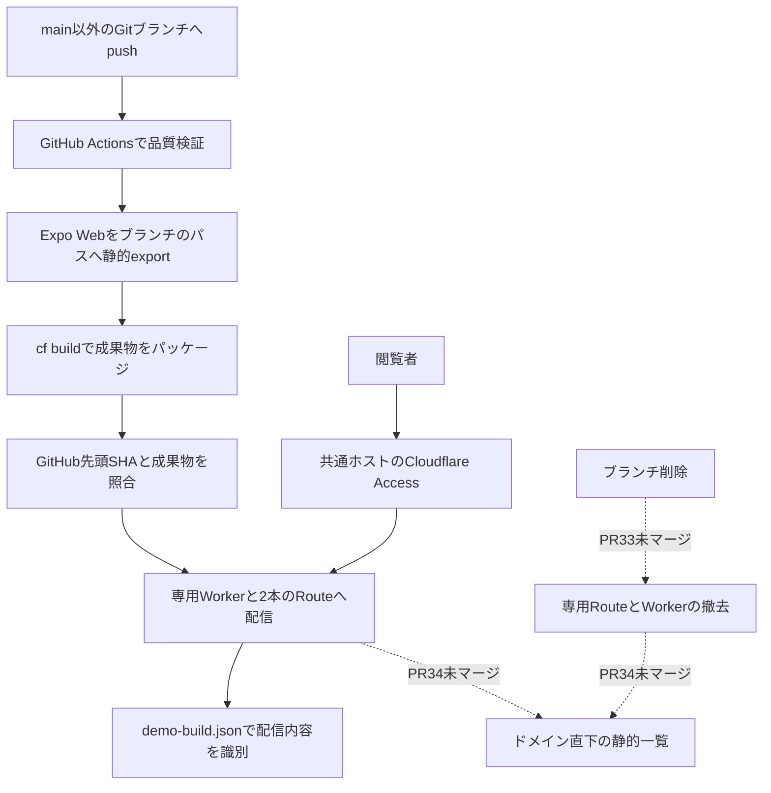

# ITOMAデモ環境基盤 — 執筆agent向け引き継ぎ

## 1. この資料の使い方

完成記事ではなく、取材メモ・一次情報・構成案・ファクトチェック項目をまとめた資料。読者はExpo/React NativeアプリのUIをURL共有したい開発者、およびAI agentを使った実装・レビューの仕組みを考えている開発者を想定する。

**記事の核**：iOSアプリの体験を早く確かめるため、既存Expo Webを使い、Gitブランチを単位に本人限定のデモを配信する基盤を作った。作成だけでなく、検証対象の識別・環境の発見・不要環境の撤去まで考えると、標準プレビューに任せる範囲と自作する範囲の比較が重要になる。

採用サービスの優劣を断定する記事にしない。CloudflareにVercel相当の機能が一切ないという主張も、本構成をCloudflareの唯一の構成とする主張も避ける。本記事はWorkersをブランチごとに作る実装例であり、Pages等を採用した場合とは分ける。

## 2. 調査基準と状態の区別

- main基準：[`d9e504e9a2c74bb8c95b0b1d3efc7ea9a01dbc9d`](https://github.com/kzk-maeda/itoma/tree/d9e504e9a2c74bb8c95b0b1d3efc7ea9a01dbc9d)。この資料作成時点。
- ブランチ配信：[PR #30](https://github.com/kzk-maeda/itoma/pull/30) はマージ済み。
- 自動撤去：[PR #33](https://github.com/kzk-maeda/itoma/pull/33)、SHA `580b718883ed6a9dd7937348f685f423bef1f3a3`、**OPEN**。
- ルート一覧：[PR #34](https://github.com/kzk-maeda/itoma/pull/34)、SHA `e13fb4eab1ae8168ea0cb4a8fed7ad2a667408a0`、**OPEN**。
- Cloudflare方針のADR 0001はmainでもProposed。本体MVPのADRとデモ配信の判断を混同しない。

公開前にPR状態と採用状態を必ず再確認する。「PRにコードがある」「CIが成功」「本番の該当機能が動いた」「認証後に人が操作した」は別の事実。

| 機能・主張 | この調査で言えること | 言えないこと |
| --- | --- | --- |
| ブランチ別配信 | mainにコードあり。ActionsのDeploy branch demoステップ成功を確認 | 全環境の現在の稼働・認証後の操作成功 |
| ブランチ削除時の自動撤去 | PR #33に実装とmockテストあり | main導入済み・本番deleteイベントで撤去成功 |
| ドメイン直下の一覧 | PR #34に実装、mock/UI/dry-runの記録あり | 実ドメインのルートに一覧が公開済み |
| PR #34のdeploy成功 | 同ブランチの既存Expoデモ配信は成功 | 新しい一覧workflowが実行された、という意味ではない |
| Access | 過去のリソース・匿名転送の記録あり | 今回Access設定を再監査・認証後表示を再検証したこと |
| Vercelとの比較 | 比較すべき要件と仮説を整理可能 | 現行プラン・保持期間・削除連動・料金を検証済みとすること |

## 3. なぜiOSアプリにWebデモが必要か

ITOMA（いとま）は、無意識のX/YouTube利用を減らし、自分の時間を取り戻すiOSアプリ。React Native + Expo Router + TypeScript、本体のOS連携はSwiftで開発する方針。Local-firstで、独自バックエンド・独自認証・Android・実決済は初版対象外。

仕事中/夜の曜日・時間帯ルール、対象アプリ、理由入力/ダミー課金/一時解除不可という挙動を本人が選ぶ構想がある。ただし現行ホームはメモリ内モック。この記事でScreen Time機能が完成したと書かない。

検証したいのは「この説明でルールを理解できるか」「現在の選択がわかるか」「反映・キャンセルが理解できるか」。スマートフォンやPCから同じURLを開いて確認できることに価値がある。

### Webで検証するもの／しないもの

| Webデモの対象 | iPhone実機等が必要な対象 |
| --- | --- |
| 情報順、文言、遷移、入力、反映・取消、模擬状態の説明 | FamilyControls、ManagedSettings、DeviceActivity |
| ブラウザーでの狭い幅・Light/Dark・キーボード確認 | Extension、権限、署名、本体終了中の再制限 |
| 仮説の共有と再現手順 | iOSのVoiceOver、Dynamic Type、ネイティブシートの操作 |

デモの画面はReact Native Web。iOS Simulatorのスクリーンショットとして紹介しない。実課金・実データ・実際のOS制限をデモへ持ち込まない。

## 4. 全体構成



公開記事のURL例は `https://demo.example.com/demos/<branch-key>/` に置き換える。実ドメインはrepo内運用資料にあるが、公開してよいか著者に確認する。

### 共有するものと分けるもの

- 共有：ホスト、DNS、Accessの本人限定ポリシー。
- 分離：ブランチ専用Worker、静的ファイル、2本のRoute。
- URLパスは認証・ストレージの隔離境界ではない。同一オリジンなのでCookie/localStorage等を自動分離しない。
- 未信頼の第三者コードを互いに隔離するsandboxではない。repoへpushできるメンバーを信頼する構成。
- 製品の認証バックエンドを作るのではなく、ホスティング側でデモの閲覧を制限する。

## 5. ブランチ配信の実装要点（main）

### 環境の名前

`demoTarget(branch)` が、元のブランチ名から環境識別子を作る。

```text
key = 小文字slug（最大36文字） + '-' + SHA-256(元のブランチ名)の先頭12桁
Worker = itoma-demo-<key>
path   = /demos/<key>
```

`feat/a` と `feat-a`、大文字小文字、切詰め後の同名を区別する意図がある。短縮hashなので数学的に衝突しないとは書かない。元のブランチ名はmanifestへ保持。同じブランチは同じURL、名前変更は別URLとなる。

2本のRouteは `/demos/<key>` と `/demos/<key>/*`。ホスト全体のルートWorkerをブランチ配信が上書きしない。

### 既存Expoの設定を壊さない

`app.config.ts` で `ITOMA_DEMO_BUILD=1` の場合だけ `web.output=static` と `experiments.baseUrl` を設定。通常のWeb設定はserver、iOS設定は維持する。

exportを `dist/demo-export/` に生成し、`dist/demo/demos/<key>/` へ物理配置して通常の静的ファイル配信にする。生成物を先に消し、前のブランチのファイルが混ざることを防ぐ。新しいWebアプリやmonorepoへ最初から移行しない判断。

### 成果物と配信先を照合

`demo-build.json` と `dist/demo-meta.json` にkind、branch/key、URL/Route/Worker、commit、dirty、builtAt、mock-onlyを記録する。

配信スクリプトは、現在のbranch/SHA/dirty、元manifestとパッケージ内manifest、Worker設定とRoute、workers.dev/preview無効、想定外Custom DomainやbasePathがないことを照合する。古い成果物・別ブランチ・未コミット状態は配信前に失敗させる。

manifestは再現性の手がかりであり、署名済み証明・改ざん防止機構ではない。ブランチコード自体を信頼するという前提も残る。

### Actionsの動作

- トリガーは**main以外の全ブランチへのpush**と手動実行。`demo/*` だけでも、PRがあるブランチだけでもない。
- 型チェック、lint、Jest、デモツールテスト、静的パッケージ生成を実行。
- 配信直前にGitHubのブランチ先頭SHAを確認。削除済み・新しいpushがある古い実行は配信をスキップする。
- ブランチ単位のconcurrency、cancel-in-progress=false。アップロード途中を強制中断せず、新しい実行を待たせる。
- この確認はGitHubとCloudflareをまたぐ原子的なロックではない。確認後のpush/削除との競合を完全に排除したとは書かない。
- `GITHUB_TOKEN`はcontents:read。checkoutの資格情報は保持せず、Cloudflareトークンは配信stepだけに渡す。
- URL/SHA/Worker名をActions Summaryへ、Version IDを配信ログへ記録する。workflow全体successだけでなく配信stepがskipでないことを確認する。

### 実装から得られた制約・つまずき

repoのリソース記録にある過去の観測。今回の資料作成で再現してはいない。

1. Cloudflareの非ルート `assets.basePath` は利用アカウントでAPI 100343。物理ディレクトリ配置に変更した。Cloudflare全体で不可能と一般化しない。
2. cf betaの新規Worker配信時に10007/404やnull tag参照エラーを観測。失敗を成功扱いにせず、対象リソースを確認し、同じ成果物で再実行した記録がある。
3. Gitブランチを切り替えたら同じSHAでも再パッケージが必要。ローカルdetached HEADとGitHub PRのdetached checkoutを区別する。
4. 専用トークンで新規Workerを作る権限と、既存Workerを更新する権限は同じとは限らない。repoではWorkers product Admin等の条件を記録しているが、公開手順は現行公式仕様で再確認する。
5. cf `1.0.0-beta.27` / Wrangler `4.157.0`をロックファイルで固定。将来も同じコマンドが動くと保証しない。

## 6. 環境の寿命とクリーンアップ（PR #33）

記事で重視したい比較軸。ブランチを作ってデプロイできるだけでは、不要環境・ルーティング・公開経路・費用の管理は終わらない。

### 採用案と除外案

- 手動だけ：初期構成としては小さいが、不要Worker/Routeを残しやすい。
- PR close/mergeで撤去：PRなしのデモを扱えず、PR後も利用したいブランチを消す。
- **Gitブランチ削除で撤去**：環境の単位と寿命を揃える、PR #33の案。
- 定期全環境の照合：イベント漏れや古い環境を回収できるが、PR #33の範囲外。

### 実装されている防護策

- deleteイベントと手動実行。手動はdry-run標準。タグ・main・default branchを除外。
- 削除されたブランチのコードではなくdefault branch上の撤去コードを実行。
- 配信と同じブランチ単位concurrencyを使う。
- GitHubで同名ブランチが不存在かを確認。再作成されていたらスキップ。確認APIの失敗を不存在と扱わない。
- 対象アカウント・zone・branch-keyに限定。RouteとWorkerの所有関係、ID、他リソースからの参照を検査。
- 共通ルートWorker、Custom Domain、DNS、Access、別ブランチを保持。
- 2本のRouteを先に削除し、その後に専用Workerを削除。force=falseで他の参照を強制削除しない。
- 変更前にも再確認し、すでにないリソースは再実行可能にする。部分失敗後の復旧を考える。

### 残る限界

mockテストの成功と、本番deleteイベントの成功は別。default branchへの導入前の削除を遡及して回収するわけではない。削除済みURLがどのHTTP応答になるかも実配信で確認する。

GitHubの再作成確認とCloudflare削除は原子的ではなく、再作成の競合を完全保証できない。削除後の参照・残存Version・URL・課金がすべて自動で消える、費用が必ずゼロになる、と一般化しない。

## 7. どの環境を開けばよいか（PR #34）

ドメイン直下を初期デモから一覧へ置き換える案。ブランチ一覧だけでは「配信成功した環境」とは限らないため、CIでCloudflareの専用Workerと2本のRouteを照合する。

- 各環境のPRタイトル・概要、ブランチ名、Worker更新時刻、デモ/PR/配信manifestへのリンク。
- PRなしはブランチ先頭コミットの件名。Gitブランチ情報がなくても配信先が残っていれば、不明・削除済み・ローカル配信と表示。
- 概要は現在のPR/ブランチ情報。配信済みSHAや配信された文言と一致する保証はない。実配信の識別は各manifestで行う。
- API取得はCI側。静的HTMLに資格情報を埋め込まず、PR由来テキストをエスケープする。新しい製品バックエンド・DBは作らない。
- Deploy demo / Cleanup demo完了、15分ごと、mainの関連ファイル変更、手動実行で再生成。
- API失敗時に「環境なし」を成功配信せず、前回の一覧を保持。更新時刻とActionsの失敗で鮮度を確認する。
- 照合時点のスナップショットであり、リアルタイム状態でもHTTPの正常性チェックでもない。
- mainの信頼済みコードのみで実行。既存Access・DNS・ブランチRouteを変更しない。root Workerの内容は置き換わる。

PR #34の画像は**固定サンプル**。画像中のPR #42/#43や環境数は実運用の証拠ではない。記事に載せるならキャプションに明示する。

## 8. CloudflareとVercelをどう比較するか

以下は比較の枠組み。Vercelへの移行・料金・動作を検証した結論ではない。今回、Vercel公式資料へのHTTP取得はプロキシ403で失敗した。会話中の説明をそのまま最新公式仕様として引用せず、執筆agentが取得可能な環境で再確認する。

| 要件 | 今回のCloudflare Workers構成 | Vercelで確認する点 |
| --- | --- | --- |
| Git pushからプレビュー | Actionsと配信スクリプトを自作 | Git連携のPreview Deploymentsで標準化できる範囲、対象ブランチ |
| URLと版の関係 | ブランチ固定パスを更新。manifestでSHAを識別 | デプロイ固有URL、ブランチalias、カスタムドメインの違い |
| 非公開共有 | ホスト共通の本人限定Access | Deployment Protectionの方式、対象環境、プラン、ゲストの操作 |
| 同一ホストのパス分離 | `/demos/<key>/` をRouteで実現 | 標準プレビューの別ホストで要件を満たすか。同じパスなら追加構成が必要か |
| 一覧・発見 | repo独自のルートページをPRで実装 | 標準管理画面で十分か。独自ドメインの一覧は別要件か |
| 再配信・復旧 | 元ブランチ/コミットで再ビルド・配信 | 履歴、rollback、保持ポリシーと権限 |
| 不要環境の整理 | Route/Workerの削除を自作 | 保持期間による自動削除、手動/API/CLI削除の対象と制約 |
| Expo対応 | デモ専用の静的exportを設定 | 同様にビルド出力・直リンク・アセット・ネイティブ依存をPoC |
| 費用・上限 | Worker/Route/ビルド/Access/CI利用を評価 | プラン、ビルド、保護、保持、チーム利用条件を同じ前提で評価 |
| 運用責任 | 認証・配信・撤去・発見を制御する分、自作保守が増える | 標準に任せる範囲とプラットフォームの制約 |

### クリーンアップ比較で混同しない6点

1. **時間経過による保持期間の削除**と、**Gitブランチ削除に連動した即時撤去**は別。
2. デプロイ本体、ブランチalias、カスタムドメイン、キャッシュ、成果物、ログは削除対象が異なる。
3. 本番・最新・保護されたデプロイ等の除外条件、ロールバックに必要な保持を確認する。
4. ブランチ再作成、古い削除イベント再実行、同時配信、部分失敗時の挙動を比較する。
5. 削除後にURLがどう見えるか、認証経路と秘密情報の残存を確認する。
6. 削除と利用料金の停止・過去料金の消滅は同義ではない。プランと対象範囲を確認する。

「Vercelではブランチを削除すれば全デプロイが必ず即削除される」「Vercelはクリーンアップ不要」「無料で同等の非公開共有ができる」は未検証で、記事に断定しない。CLIの存在と、要件を満たす自動運用が標準であることも別。

### 現時点での見解（事実とは分けて書く）

標準のPRプレビューで十分なら、Vercelに任せることで自作の配信・発見・保持管理を減らせる可能性がある。一方、既存Accessと同一ホストのパス設計を重視するなら、今回のCloudflare構成には制御しやすさがある。

今回の静的デモには新しいWorker実行APIは不要。将来のWorkers拡張を、今すぐ必要な利点のように誇張しない。すでに実装した工数だけを理由に継続を正当化せず、移行費用と今後の運用費用を比較する。

## 9. 一次情報と証拠

### mainの実装・運用資料

以下はこの資料と同じmain系列の相対リンク。記事の最終版では対象commitに固定したGitHubリンクを使う。

- [設定の切替](../../app.config.ts)
- [環境識別・配信ガード](../../scripts/lib/demo-target.mjs)
- [Git情報の取得](../../scripts/lib/demo-repo.mjs)
- [静的exportとmanifest](../../scripts/build-demo.mjs)
- [配信](../../scripts/deploy-demo.mjs)
- [Worker構成](../../cloudflare.config.ts)、[Wrangler構成](../../wrangler.config.ts)
- [配信workflow](../../.github/workflows/deploy-demo.yml)、[品質CI](../../.github/workflows/ci.yml)
- [既存デモテスト](../../tests/demo-tools.test.mjs)
- [運用手順](../demo-environment.md)、[リソースと過去検証](../cloudflare-resources.md)
- [ADR 0001](../adr/0001-cloudflare-web-demo.md)、[デザイン原則](../../DESIGN.md)

mainの運用資料には初期時点の「Secret未登録・Actions配信未検証」が残る。後続のActions成功と矛盾するように読めるため、時系列を示し、古い記録だけで現在状態を断定しない。

### 未マージ実装（固定SHA）

- [撤去コード](https://github.com/kzk-maeda/itoma/blob/580b718883ed6a9dd7937348f685f423bef1f3a3/scripts/lib/demo-cleanup.mjs)、[撤去workflow](https://github.com/kzk-maeda/itoma/blob/580b718883ed6a9dd7937348f685f423bef1f3a3/.github/workflows/cleanup-demo.yml)、[撤去テスト](https://github.com/kzk-maeda/itoma/blob/580b718883ed6a9dd7937348f685f423bef1f3a3/tests/demo-cleanup.test.mjs)
- [一覧生成・API照合](https://github.com/kzk-maeda/itoma/blob/e13fb4eab1ae8168ea0cb4a8fed7ad2a667408a0/scripts/lib/demo-index.mjs)、[一覧workflow](https://github.com/kzk-maeda/itoma/blob/e13fb4eab1ae8168ea0cb4a8fed7ad2a667408a0/.github/workflows/demo-index.yml)、[一覧の検証・画像](https://github.com/kzk-maeda/itoma/blob/e13fb4eab1ae8168ea0cb4a8fed7ad2a667408a0/docs/demo-index-review.md)

### 今回読み取り確認したActions

| 実行 | 確認した内容 | 証明しないもの |
| --- | --- | --- |
| [41859260612](https://github.com/kzk-maeda/itoma/actions/runs/41859260612) | `feat/demo-environment-index` / `e13fb4e`。品質・package・先頭確認・Deploy branch demo・URL記録stepすべてsuccess | root一覧の配信、本人認証後のUI、撤去 |
| [41832698598](https://github.com/kzk-maeda/itoma/actions/runs/41832698598) | `feat/cleanup-branch-demos` / `580b718`。同じ配信step成功 | deleteイベントでの撤去成功 |
| [41828277172](https://github.com/kzk-maeda/itoma/actions/runs/41828277172) | 過去配信の記録を確認する入口 | 本資料作成時の再実行ではない |

ライブCloudflareリソースの再照合や認証後ブラウザー操作は今回していない。成功した配信runの数を現在のアクティブ環境数として数えない。

### 公式資料の確認先

Vercelは今回未取得。Cloudflareのリンクもrepoの参考情報であり、公開手順を確定する前に現行仕様を再確認する。

- [Vercel Git](https://vercel.com/docs/git)、[Deployments](https://vercel.com/docs/deployments)
- [Deployment Protection](https://vercel.com/docs/deployment-protection)、[CLI](https://vercel.com/docs/cli)、[remove](https://vercel.com/docs/cli/remove)
- [Vercel Pricing](https://vercel.com/pricing)。保持ポリシーの現行ページはDeployments配下から確認する
- [Workers Static Assets](https://developers.cloudflare.com/workers/static-assets/)、[Workers authorization](https://developers.cloudflare.com/workers/authorization/workers/)
- [cf CI](https://developers.cloudflare.com/cf/ci/)、[Pages previews](https://developers.cloudflare.com/pages/configuration/preview-deployments/)
- [Cloudflare Access](https://developers.cloudflare.com/cloudflare-one/access-controls/)
- [Expo static rendering](https://docs.expo.dev/router/web/static-rendering/)
- [GitHub concurrency](https://docs.github.com/en/actions/how-tos/write-workflows/choose-when-workflows-run/control-workflow-concurrency)

## 10. 記事構成案

### タイトル候補

- 「iOSアプリの仮説をURLで試す：Expo WebとCloudflareでブランチ別デモを作った」
- 「デモは配信して終わりではなかった：ブランチ別環境の発見・認証・撤去まで考える」
- 「Vercelならもっと簡単？ Cloudflareでデモ基盤を作って見えた比較軸」

### 推奨する章立て

1. 誰の何を早く確かめたいのか。iOSアプリでもWebで共有できる範囲がある。
2. 要件：同じホスト、本人限定、ブランチ別、SHAで識別、既存Expoを再利用。
3. 全体図と、push→検証→静的export→配信→URL共有の実例。
4. slug/hash、パス配置、manifest、先頭確認のコードを短く解説。
5. Accessと同一オリジンの限界。本人限定だからこそ可能な信頼モデル。
6. 環境が増えると「どれを開くか」「いつ消すか」が必要になる。PR #33/#34の導入状態を正しく紹介。
7. つまずきと運用負担。beta CLI、API条件、古い成果物、最小権限の難しさ。
8. Vercelとの比較。作成だけでなく、保護・発見・保持・ブランチ削除連動・復旧を同じ要件で評価。
9. WebデモとiOS実機検証を分け、次に減らしたい不確実性を示す。

開発ストーリーとしてAI agentを扱う場合は、「agentが何を提案・実装したか」「人間が何を決めたか」「CIで何を確かめたか」を分ける。自律実機QA・自動マージ・無人公開まで完成したように書かない。

### 推奨素材

- 製品検証とWebデモ検証の境界図、配信フロー、Worker/Route/Accessの構成図。
- ブランチをpushしたActions Summaryと、そのSHAに対応するmanifestの対。
- 末尾スラッシュなし、直リンク、リロード、JS/画像に対するAccess確認の実録。
- 一覧は実環境のキャプチャを取得するか、固定サンプルと明記した既存画像を使う。
- 撤去はmain導入後に専用検証ブランチで取得できた場合だけ、前後のリソース数と対象を示す。記事のために無断で削除しない。

## 11. 著者に確認する事項

- 主要な読者と主題：実装チュートリアル、AIとの開発記、サービス比較のどこを中心にするか。
- 実ドメイン・GitHub名・repoへのリンク・Cloudflare管理画面の公開可否。
- 本人限定のまま紹介するか。読者向けにURLを開放することは別の承認が必要。
- PR #33/#34をマージ・実環境検証してから記事にするか、開発途中として紹介するか。
- Vercelの小さいPoCまで実施するか。現状は移行判断済みではない。
- 実測の費用や作業時間を掲載するか。請求・計測の証拠がなければ数字を作らない。

## 12. 公開前チェック

- [ ] main SHA、PR #33/#34、ADR状態、最新workflowを再確認
- [ ] 各主張を「コード」「CI」「配信」「認証後操作」「実機」「未検証」に分類
- [ ] VercelのPreview/Protection/Retention/削除APIを公式資料で確認し、確認日・プラン・対象条件を記録
- [ ] クリーンアップのライフサイクルとURL/alias/資源/保持の違いを比較
- [ ] Cloudflareを選ぶ理由を後付けせず、自作保守・権限範囲・料金上限も記載
- [ ] 画像がWebかSimulatorか、固定fixtureか実環境か、対象SHAを表示
- [ ] URLだけで配信SHAを固定できると誤解させない
- [ ] Token、Cookie、OTP、JWT、メール、個人入力、不要なaccount/zone/Worker/Access IDを画像・ログから除く
- [ ] 本人認証やアクセス制御を記事撮影のために外さない
- [ ] 記事のPR作成と記事公開・環境配信を区別し、許可なしに公開・移行・削除しない

## 13. 執筆agentへ渡す依頼文

```text
この資料を一次情報への索引として読み、ITOMAのブランチ別Webデモ基盤を紹介する記事草稿を日本語で作成してください。

目的は、iOSアプリの体験をExpo Webで共有する仕組みと、配信だけでなく認証・環境識別・発見・撤去まで設計した理由を読者が判断できることです。

最初に資料中のmain SHAとPR #33/#34の最新状態、実装、Actionsの配信stepを再確認してください。GitHubの状態を読めない場合は、その限界を明記してください。
コードがある、テスト成功、配信成功、認証後UI検証、iOS実機検証を区別し、未確認を事実に変えないでください。

Vercelとの比較では現行公式資料を調べ、プランと確認日を記録してください。特に、保持期間に基づく削除とGitブランチ削除に連動する撤去を同一視しないでください。
同一ホストのパス、本人限定共有、標準管理画面と独自一覧、URL/alias/デプロイの寿命、復旧、コスト、自作保守の要件を揃えて比較してください。
Cloudflare Workersの今回の構成と、Cloudflare全体の機能を混同しないでください。

この記事のためにインフラ変更・デプロイ・撤去・Access開放・サービス移行を実行しないでください。秘密情報や個人情報を読んだり掲載したりしないでください。
画像はWeb/実機/fixtureを明示し、公開可否が不明なドメインはdemo.example.com等へ置換してください。

まず読者・主題・構成を示し、記事草稿とファクトチェック表をrepo内へ保存し、作業ブランチからPRで提出してください。記事の公開・mainへのマージは行わないでください。
```
